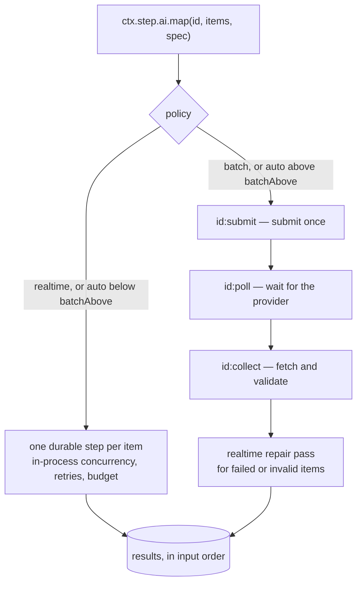

# Batch Operations

AI batch APIs (Google Batch, Anthropic Message Batches, OpenAI Batch, OpenRouter's `:batch` endpoint) offer substantial per-model discounts for non-realtime workloads. They are asynchronous: a batch takes anywhere from minutes to 24 hours.

In **workflow-engine** a batch is a [durable step](../core-concepts/durable-steps.md). `ctx.step.ai.map` submits the fan-out once, records the handle in the step ledger, suspends the stage while the provider works, polls from the host's maintenance tick, and collects the results with your schema re-applied. A crash between submit and collect resumes from the ledger rather than resubmitting. The same call runs realtime for small inputs, so one stage serves both.

The 0.x `defineAsyncBatchStage` with a hand-written `checkCompletion` is not exported from 1.0; see [Migrating from 0.13 to 1.0](../migrations/migrate-0.13-to-1.0.md) for the before/after.

---

## `ctx.step.ai.map`

One prompt per item under an execution policy, with schema validation and repair applied identically on the realtime and batch paths. Results come back in input order.

```typescript
import { defineStage } from "@bratsos/workflow-engine";
import { z } from "zod";

const AnalysisResultSchema = z.object({
  sentiment: z.enum(["positive", "negative"]),
  topics: z.array(z.string()),
});

export const batchAnalysisStage = defineStage({
  id: "batch-analysis",
  name: "Batch Analysis",
  schemas: {
    input: z.object({ items: z.array(z.object({ id: z.string(), feedback: z.string() })) }),
    output: z.object({ analysed: z.number(), failed: z.array(z.string()) }),
    config: z.object({}),
  },
  async execute(ctx) {
    const results = await ctx.step.ai.map("analyse", ctx.input.items, {
      model: "gemini-2.5-flash",
      schema: AnalysisResultSchema,
      prompt: (item) => `Analyze sentiment and extract topics: ${item.feedback}`,
      itemId: (item) => item.id,           // stable per-item step id; defaults to the index
      repair: { attempts: 1 },             // re-prompt once on a schema failure
      policy: "auto",                      // batch at or above `auto.batchAbove` items
      auto: { batchAbove: 20 },
      batch: { pollEvery: "60s", timeout: "24h", onExpiry: "fail" },
      realtime: { concurrency: 10, budget: 500, minDelayMs: "1s" },
    });

    const failed = results.filter((r) => r.status === "failed").map((r) => r.id);
    return { output: { analysed: results.length - failed.length, failed } };
  },
});
```

### The spec

| Field | Meaning |
| :--- | :--- |
| `model` | Registry key of the model to call. |
| `prompt(item, index)` | Builds the prompt for one item (string or content parts). |
| `schema?` | Zod schema each result is validated against and repaired towards. |
| `itemId?(item, index)` | Stable id used to key the item's durable step (`${id}:${itemId}`). Must be unique; `submit`, `poll` and `collect` are reserved. |
| `repair?` | `{ attempts }` re-prompts after a schema failure with the previous output and the Zod issues appended. Default `{ attempts: 1 }`. |
| `policy?` | `"auto"` (default), `"realtime"` or `"batch"`. Forcing batch on a model that cannot batch throws. |
| `auto?` | `{ batchAbove }` — item count at or above which `auto` uses batch (default 20). |
| `batch?` | `provider`, `options` (`BatchOptions`), `pollEvery` (default `"60s"`), `timeout` (default `"24h"`, non-sliding), `onExpiry: "fail" \| "partial"`, `onReclaim: "adopt" \| "resubmit"`. |
| `realtime?` | `concurrency` (default 10), `budget` (max model calls per stage invocation), `retries` (default 1), `retryDelayMs`, `minDelayMs` (milliseconds or a duration string; `0`, the default, turns each off, otherwise from 1 to 2147483647 ms, else a `RangeError` names the option before any call). |
| `stream?` | Run realtime items through `ctx.ai.streamText` and collect the text (for hosts that kill an idle connection). Ignored by the batch path. |
| `system?`, `maxTokens?`, `temperature?` | Forwarded to the model call. No default `temperature` is sent. |

### Policy resolution



`auto` uses batch when there are at least `auto.batchAbove` items, the model's registry entry has `supportsAsyncBatch`, a batch provider resolves, and every prompt is a string; otherwise realtime. The provider resolves in this order: `batch.provider` on the call, the model's `batchProvider` registry field, the native vendor (the entry's `provider` when it is `"google"`, `"anthropic"` or `"openai"`, else the vendor named by the slug), then OpenRouter. Register `batchProvider: "openrouter"` on a model you call through OpenRouter to batch it there. When the native SDK is unavailable or lacks a batch interface and OpenRouter can batch the model, the helper can fall back to OpenRouter using the client options and the provider policy rules below.

Once a batch is submitted, its polls and collect go through the transport recorded in the stored refs, whatever the registry resolves later.

### Realtime path

Each item is a durable step `${id}:${itemId}` run under an in-process semaphore of `concurrency`. A thrown model call (transport, quota, timeout) is retried **in-process** — wait `retryDelayMs`, bump the ledger row's `attempt`, call again — up to `realtime.retries` times; the stage never suspends for a map item. A model call that throws `NonRetryableError` fails its item at once, spending no retry and no repair. `budget` caps model calls including repairs per stage invocation: exceeding it before an item's first call throws `AiMapBudgetExceededError`; a repair that would exceed it returns the item as failed. `minDelayMs` is the minimum spacing between calls *on one concurrency slot* (with `concurrency: 4` and `minDelayMs: "1s"`, at most four calls per second) and replaces hand-written cooldowns.

### Batch path

- **`${id}:submit`** submits the fan-out exactly once and stores the handle, refs and request ids. Because a crashed worker's re-run of a submit is the one replay that costs real money, the submit is stamped with the step's `externalKey` (OpenAI batch `metadata`, Google `displayName`), and a reclaimed submit adopts the batch already carrying that key instead of creating a second one. Anthropic Message Batches and OpenRouter have no field the engine can stamp and search, so a reclaimed submit there throws `BatchNotAdoptableError` rather than silently paying twice; `batch: { onReclaim: "resubmit" }` accepts the duplicate cost.
- **`${id}:poll`** is a `waitFor` with a stored, non-sliding deadline (`batch.timeout`).
- **`${id}:collect`** fetches results with the schemas re-supplied (so `validated` is true), stores a summary on the collect row, and writes each item's verdict to its own `${id}:${itemId}` row. Items that failed or did not validate then go through the realtime repair pass.
- Requests are partitioned per response schema (Google requires one schema per batch) and into chunks of `maxRequestsPerBatch` (OpenRouter, default 500). Structured-output schemas are rewritten per target at the model boundary (`oneOf` → `anyOf`, `additionalProperties: false` and every property `required` for OpenAI strict mode, records as `{ key, value }` arrays, Gemini's OpenAPI dialect) and the reply is transformed back before validation; a schema keyword no rewrite can express fails at submit with `UnportableSchemaError` rather than a provider error per item.
- When the batch settles with provider-side item failures the poll logs a WARN, and when more than half of a batch fails validation `getResults` logs a WARN naming the batch id and the first issue — the signal that every item is being paid for twice.

### Results

```typescript
type AiMapResult<TOut> =
  | { id: string; index: number; status: "succeeded"; result: TOut; validated: boolean;
      attempts: number; inputTokens: number; outputTokens: number; cost: number }
  | { id: string; index: number; status: "failed"; error: string; errorName?: string;
      attempts: number; inputTokens: number; outputTokens: number; cost: number };
```

**Failed items do not fail the stage.** An item whose retries and repairs are exhausted comes back as `status: "failed"` and the map still resolves; deciding what that means is the stage's job. `errorName` is the `Error.name` of the last failure (`StepTimeoutError`, `AiMapBatchFailedError`, `AiMapBatchItemFailedError`, `AiMapBatchItemMissingError`, or a transport error's name), so a caller can tell a quota error from a content failure without matching on the message. `onExpiry: "fail"` (default) throws `AiMapBatchFailedError` when the batch fails or the wait times out; `"partial"` returns every item as failed with that error instead. `cost` per item is the recorded cost summed over its attempts; batch items use the transport-aware batch price.

A new job attempt of the stage re-opens failed item rows and re-prompts them; a replay of the same attempt reports the stored verdict without a model call.

### Cancelling a run

A batch is billed from the moment the provider accepts it, so `run.cancel` cancels the provider batches the run created, after the cancel has committed. It finds them from the step ledger: a `run` step whose id ends in `:submit` and whose stored result is the submit record (`handleId`, `refs`, `requestIds`, `totalRequests`, every ref a valid `EngineBatchRef`) is a candidate; a result spilled to the blob store is resolved first. The shape is not ownership, though: an ordinary step can memoise a handle of its own. The engine cancels a record only when it can prove it wrote it, and the proof is `externalKey` inside the record, equal to the external key of the row it sits in. A record without it, or with another step's key, is reported as `unverified` and left alone. That includes every record written before this release, which carries no such field: a run submitted by an older version is not cancelled by `run.cancel` (cancel its batches at the provider, by the ids in `result.batches`). Batches are found across every stage record of the run, and each one gets an outcome in `result.batches`:

| `status` | Meaning |
|----------|---------|
| `cancelled` | The provider has the batch cancelling or cancelled (the call was sent, or the batch already was). Requests the provider was already executing can still finish and bill. |
| `already-terminal` | The batch had ended on its own (completed, failed, expired); nothing was cancelled. |
| `unsupported` | The transport has no cancel call. The batch keeps running. |
| `unavailable` | No transport could be built in this process: no credentials, the vendor package is missing, or the provider is not a built-in one. |
| `failed` | The provider call threw, outlived its time budget, or was not reached (see *Time bounds*); `error` says why. The batch may still be running. |
| `unrecorded` | A submit step of the run holds no batch handle: it was executing, or it failed before recording one, so a batch may exist that the engine cannot name. The outcome has no `ref` and carries the step's `externalKey`; the WARN log names it too. Find it at the provider (see *Finding a batch at the provider* below), or repeat `run.cancel` once the step's lease has expired. A submit step that is executing, or whose process stopped while it was executing, keeps its lease for 5 minutes from when it claimed the step (the default step lease; `ctx.step.ai.map` does not extend it). Until then the sweep leaves the step to that execution and reports it `unrecorded`, even when its row already lists the batch. A `run.cancel` repeated after that takes the step over and cancels what the row lists. |
| `unverified` | The step holds a handle the engine cannot prove it created (see above). Not cancelled. |
| `held` | Another `run.cancel` sweep holds the submit step that lists the batch: one still running, or one whose process stopped while holding it. This command did not touch the step, so the batch may still be running. `heldUntil` is when the hold ends; repeat `run.cancel` after then and it takes the step over and finishes the cancel. A step that lists no batch is reported once, without `ref`. |

`unsupported`, `unavailable`, `failed`, `unrecorded`, `unverified` and `held` also write a WARN log on the run naming the batch, with the outcome as its metadata (for `held`, the WARN says to repeat `run.cancel` after `heldUntil`). The run ends `CANCELLED` in every case: a provider cancel that fails or is impossible neither fails nor undoes the cancel.

| Provider | Cancel call | Notes |
|----------|-------------|-------|
| OpenAI | `POST /v1/batches/{id}/cancel` | The batch is `cancelling` for up to 10 minutes, then `cancelled` with any partial results in the output file. |
| Anthropic | `POST /v1/messages/batches/{id}/cancel` | The batch is `canceling`, then `ended`; `request_counts.canceled` is the number cancelled, and requests that cannot be interrupted may still complete. |
| Gemini | `POST /v1beta/batches/{name}:cancel` | Best effort; the batch reaches `JOB_STATE_CANCELLED`. |
| OpenRouter | none | The batch API documents "no cancel endpoint yet"; `DELETE /batches/{id}` only removes a batch that already ended. |

**Finding a batch at the provider.** A WARN or an outcome that names a batch carries its id (`ref.id`) when the engine has one, and always the submit step's external key. With the id, read and cancel the batch directly. Without it (`unrecorded`, or the residual cases below), what you can search depends on what the provider stores. This follows each provider's current API reference:

| Provider | With the batch id | Without it |
|----------|-------------------|------------|
| OpenAI | `GET /v1/batches/{id}`, then `POST /v1/batches/{id}/cancel`. | The engine stamps the external key into the batch's `metadata.workflow_engine_external_key`. `GET /v1/batches` takes only `after` and `limit` (1 to 100) and has no metadata filter, so page through it and match that field. |
| Gemini | `GET /v1beta/{name}` (`batches/...`), then `POST /v1beta/{name}:cancel`. | The engine sets the batch's `displayName` to the external key. `GET /v1beta/batches` pages with `pageSize` and `pageToken`; its `filter` is not documented for display names, so match `displayName` yourself. |
| Anthropic | `GET /v1/messages/batches/{id}`, then `POST /v1/messages/batches/{id}/cancel`. | A Message Batch has no field the engine can set, so nothing at Anthropic carries the external key. `GET /v1/messages/batches` lists every batch of the workspace, newest first (`before_id`, `after_id`, `limit` 1 to 1000, no filter). Narrow it to `processing_status: "in_progress"` batches whose `created_at` is near when the step ran (the WARN's time, the stage's `startedAt`) and whose `request_counts.processing` equals the step's item count, then cancel the match. A request's `custom_id` is visible only in the results, after the batch ends. Every batch ends by itself at `expires_at`, 24 hours after it was created. |
| OpenRouter | `GET /api/v1/batches/{id}`. There is no cancel endpoint: the batch runs until it ends. | No metadata field. `GET /api/v1/batches` lists newest first and filters by `status`, `created_after` and `created_before` (with `limit` up to 100 and `after`), so narrow it to running batches created near when the step ran, for the step's model. |

The engine reads the batch first and sends the cancel only to one that is still running, because the providers document no behaviour for a cancel sent to a batch that ended. A batch that is already cancelling, cancelled or ended is reported as it is and not sent a second call. The vendor transports use the vendor SDK's `doCancelBatch`; a vendor release without it has no cancel and its batches are `unsupported`.

**Which process cancels.** `run.cancel` may be dispatched by a process that never ran the stage, so the stored ref (`provider`, `modelId`) is all it has. By default the engine builds the built-in transport the ref names and takes the credentials from the environment (`OPENAI_API_KEY`, `ANTHROPIC_API_KEY`, `GOOGLE_GENERATIVE_AI_API_KEY` or `GEMINI_API_KEY`, `OPENROUTER_API_KEY`); a process without them reports the batch as `unavailable`. When the credentials live elsewhere (for example in `batch.options` on the stage), give the kernel a resolver:

```typescript
const kernel = createKernel({
  // ...
  services: {
    batchModels: (ref) =>
      resolveBatchModelForRef(ref, { apiKey: secrets.apiKeyFor(ref.provider) }),
  },
});
```

**Repeating the command is the recovery.** A second `run.cancel` on a `CANCELLED` run returns `cancelled: false` (that flag is `true` only for the command that moved the run to `CANCELLED`), but it re-reads every batch of the run and retries each cancel that did not take effect, reporting all of them in `batches`. A submit step another sweep holds is reported as `held` with the hold's end (`heldUntil`, at most `batchCancelTimeouts.sweepMs` + `batchMs` after the hold was taken, 90 seconds by default): a sweep that is still running finishes it, and the hold of a sweep whose process stopped expires, so the `run.cancel` repeated after `heldUntil` takes the step over and completes the cancel. Run it from a process that has the credentials, or after the provider recovers. It does not retry the job update (see [Authoritative Cancellation](../core-concepts/execution-model.md#authoritative-cancellation)). A run that is `COMPLETED` or `FAILED`, or does not exist, returns `batches: []` and nothing is touched: a `FAILED` run keeps its batches because `run.redrive` re-adopts a live one.

**Redriving after a cancel.** `run.redrive` keeps a stage's completed steps, so on its own it would replay the stored submit and wait on a dead batch. When the engine has cancelled every batch of a `${id}:submit` row, or found each one already cancelled, it writes a tombstone (`engineCancelled`) into the stored submit record and re-opens the row (`running`, no lease). The next execution of that submit, and only that one, creates a new batch on every transport, with no `batch.onReclaim` setting and without the adoption search that Anthropic and OpenRouter cannot do. The new batch is generation 1 of the step: its poll and collect steps are `${id}:poll.1` and `${id}:collect.1` (generation 2 is `.2`, and so on; the first batch keeps `${id}:poll` and `${id}:collect`). The ids the engine cancelled are kept in the record (`cancelledBatchIds`, carried forward to every later record of the step), and a search for the external key never returns one of them: Gemini cancels asynchronously and keeps listing the batch as running until the cancel lands, so the batch status alone cannot be trusted for a while after `run.cancel`. A poll or collect row the cancelled batch left behind, which a redrive keeps when it is completed, is therefore never replayed for the new batch, and an old pending `${id}:poll` is dropped by the redrive, so a redrive made long after the cancel does not meet the old wait's deadline; the new wait gets a full `batch.timeout`. An item id of `poll.1`, `collect.2` and so on is reserved like `poll`. A crash while the replacement is being created is an ordinary crash: the next takeover searches for the external key, as for any submit. A `run.redrive` that finds a submit step a cancel sweep still holds leaves it to the sweep and reports it in `RunRedriveResult.batches` as `held`, with `heldUntil`: the redriven step waits until the sweep gives the row back or the hold ends, then completes any cancel the sweep recorded (replacing the batch) or, when none was sent, goes on with the recorded batch. A `run.redrive` from the start deletes the stage records and their ledger rows; a batch's external key names its stage record, so nothing could find such a batch again. When a cancel was asked for on a submit row the redrive deletes (a sweep held it, or recorded `cancelIntent`), or a row it reads owes a cancel (`cancelOwed`), the redrive sends those cancels after its commit and after the run is enqueued, and reports each in `RunRedriveResult.batches`: `cancelled` (or `already-terminal`), or the status with an `error` and a WARN on the run naming the batch, which must then be cancelled at the provider. On a `CANCELLED` run it does the same for every batch of a stage record it deletes whose stage had not completed: the engine-owned refs of its submit rows and a legacy stage's `suspendedState` refs, unless they are recorded as cancelled. `run.cancel` asked for those cancels, and a sweep still running when the redrive read the rows can record its own cancel too late to be read. Before the commit, the redrive writes a WARN on the run that names every batch it is about to cancel; after the commit, one line per batch gives the outcome (INFO when the provider answered, a WARN otherwise). A batch named in the first WARN with no outcome line after it was not answered, because the redrive's process stopped first: a batch of a deleted record has nothing else to cancel it, so cancel it at the provider; a batch owed on a kept step stays owed there. On a run that was not cancelled, a deleted row with batches and no recorded cancel is not cancelled: its batches are abandoned, as the abandoned-step WARN and the superseded-attempt annotation say. `batches` is absent when there is nothing to report.

**Rolling deploys.** A worker on a release before this one cannot see the tombstone: after a `run.cancel` and a `run.redrive` it re-opens the submit step as a crash recovery and adopts the cancelled batch by its external key while the provider still lists it (Gemini cancels asynchronously), and the stage then fails on it. Every process that executes or polls jobs must run this release before you rely on `run.cancel` followed by `run.redrive` for runs with provider batches.

When a batch of the row was not confirmed cancelled the engine keeps its conservative behaviour: a batch that is `unsupported`, `unavailable`, ended on its own, or `failed` before any request was sent keeps its row, so a redrive waits on the live batch or collects the finished one (a `failed` batch whose request was sent is different, see "Intent before the request" below); a submit that fanned out into several batches of which only some were cancelled is re-opened without the tombstone, so it adopts per batch where the transport can and refuses with `BatchNotAdoptableError` where it cannot.

**A stage that is executing.** A body running when the run is cancelled sees `ctx.abortSignal` abort, and the engine stops it from starting anything new: no durable step body starts once the signal reports the cancel (`ctx.step.run` and every step built on it, `ctx.step.ai.*` included, throw the stage's `StageAbortedError` before the body and write no row, so a redrive does not count the step as an attempt; a step that already completed still answers from the ledger). A submit that was already in flight when the cancel landed is cancelled by the body itself, and its step row keeps the batch record with the tombstone, so a redrive replaces it as above.

**A body in another process.** A body whose abort signal has not fired yet can still create a batch after `run.cancel` read the ledger. Every place where a handler that ran a stage body finds its run `CANCELLED` therefore cancels the run's batches too, after its own commit: the four `ghost` exits of `job.execute` that follow a body (the fenced commit of the body's failure, the status re-check before a suspension, and the suspension and completion commits), a `stage.pollSuspended` replay whose stage a cancel moved while its body ran, and both `CANCELLED` branches of the claim every `stage.pollSuspended` replay ends in. The handle the body recorded is in the ledger by then and is found. A run that is `FAILED` is not swept.

**A body that lost its submit row.** A submit body whose lease lapsed can return after another execution or a sweep took its row over: after a cancel and a redrive, the old generation's body and the new one can both create a batch. The old body's outcome is not recorded (a submit step records it only at the attempt it claimed; see [Durable Steps](../core-concepts/durable-steps.md#when-two-workers-reach-the-same-step)), so before it ends, the body cancels each batch it created that the row does not list. When nothing holds the row (it is completed, failed, or released by a sweep with no lease), the batch is first recorded in the row's `cancelOwed`, so it is never adopted, and then cancelled; once the provider answers, the id leaves `cancelOwed` (for `cancelledBatchIds` when it was cancelled). The write moves the row's attempt, as a sweep's hold does, so a sweep that read the row before it cannot hold the row without the record. A batch still in `cancelOwed` is a cancel nobody has completed: the body's process stopped before the request left, or the request failed. The next `run.cancel`, a `run.redrive` (which reports it in `RunRedriveResult.batches`), the step's next execution while the row is open and, once the row is completed (or failed with no retry left), the next replay of the stage that reads it each send it, whatever the run has become since, because nothing waits on that batch. A completed submit step is replayed, not executed again, on every poll and collect of its stage (a failed one with no retry left is replayed by throwing its stored error), so a run that simply goes on completes the cancel at its next poll. The replays are bounded by what the row records, so the bound holds across processes. After a failed attempt a replay waits before the next one: 1 minute, then 2, 4 and so on, at most 1 hour (`cancelRetry` on the row: the attempts so far, when the next is due, and the kind of failure). It writes a WARN on the run only when the kind of failure is new or changed (an error from the provider call, no answer for the batch, a transport with no cancel call in this process), not on every attempt. So a stage that polls for hours while a cancel keeps failing sends a few dozen cancels and one WARN. The step's own execution, `run.cancel` and `run.redrive` ignore the wait and send at once. A provider that has no cancel call at all (OpenRouter) answers that once: the id leaves `cancelOwed` for `noCancelBatchIds`, one WARN names it and says to cancel it in the provider's console if it has one or let it end, and it is never sent again or adopted. One case is left: a body that records the owed id after the stage's last replay (the stage has completed or failed) and whose process stops before the request leaves. Unless the run is redriven, nothing reads that row again, and the batch runs until it ends. It stays named by id in the row's `cancelOwed`, and by the step's external key in the stage's WARN that the execution lost the step to another one. An id in `cancelledBatchIds` is a cancel the provider acknowledged. When a sweep holds the row, the batch is cancelled without a write. When the row is gone with its stage record, the batch is cancelled. When another live execution holds the row, the batch is left for it to adopt by the external key, with a WARN that names it, on a transport that can search for it (OpenAI, Gemini; `AIBatch.canAdopt`). On a transport that cannot (Anthropic, OpenRouter), the other execution lists only the batches the row held when it claimed the step and the ones it creates itself. So after reading the row again, the body cancels each batch it created that the row does not list. If the answer to the `cancelOwed` write is lost, the body reads the row again; a batch the row already records there is still cancelled by the body that created it. A body whose run was cancelled while its submit was in flight, and whose own cancel finds the row taken over, hands its batches to this same cleanup. A cancel that fails leaves that batch running and owed, with a WARN on the run naming it and the external key. A cancel sent with no record (a sweep holds the row, or the row is gone) that fails is named only by that WARN.

**Which cancel it belongs to.** The sweep is tied to the cancelled run generation (`redriveCount`, with the run `CANCELLED`) and checks it before it reads anything, after it has taken hold of the ledger rows, and before every provider call; a sweep held up past a `run.redrive` (a slow provider, a slow job update) gives up without touching a batch, so it never cancels the batch of a run that is `RUNNING` again. Between the first check and the provider call the sweep holds each submit row it will act on. Taking hold is a takeover: one compare-and-set moves the row from the status and attempt the sweep read to `running` at `attempt + 1`, with a lease that starts when the row is taken and a fence. So two sweeps that read the same row cannot both hold it, every later write of the sweep is pinned to its attempt (a sweep whose hold was taken over writes nothing more and reports the batch `failed`), a replay of that step (a redriven stage) meets an executing step and waits instead of proceeding with the stored handle, and the ledger reset that `run.redrive` performs leaves the row alone. The exception is a row the sweep finds gone, deleted with its stage record by a `run.redrive` from the start while the sweep held it: the sweep sends the cancel for each batch it held, with no record and whatever the run has become, and reports it with an `error` that says so. A batch a row owes a cancel (`cancelOwed`) is cancelled whatever the run has become, too. When the sweep is done it releases the row: untouched when nothing was sent or the run moved on, otherwise with `cancelledBatchIds` (and the tombstone when every batch was cancelled).

**Intent before the request.** Before the provider call for a batch, the sweep records on the row that a cancel may be sent (`cancelIntent`). Only when that write applied, the run generation is unchanged, the call fits inside the hold and the batch budget is not spent does the request leave the process; otherwise nothing is sent, and the row is given back without the intent this sweep recorded (it keeps one the row carried before the hold), so a redriven step does not cancel a batch no request reached. A batch stays in the intent until its outcome is known: confirmed cancelled, or found ended. When the answer was an error, timed out, or never came because the process died, the batch stays in the intent and the row is re-opened, because the provider may have accepted the cancel: nothing continues on that batch. Whoever executes the step next completes the cancel first:

| What the step finds | What it does |
|---|---|
| a fence and no intent (the sweep died before it sent anything) | continues on the recorded batches, no adoption search, no refusal |
| an intent; the repeated cancel confirms every batch cancelled | records them, tombstones the record, replaces the batches on any transport |
| an intent; a batch had ended on its own (`already-terminal`) | collects it; batches it confirmed cancelled are recorded |
| an intent; the cancel cannot be completed (an error, or a transport with no cancel call) | fails retryably with a WARN, keeps the fence and the intent; the next attempt tries again |

A repeated `run.cancel` does the same: it takes the row over, repeats the cancel (idempotent: the transports read the batch first, so a cancel that landed is reported `cancelled`, a batch that ended `already-terminal`) and releases the row as an uninterrupted sweep would. What counts as "ended" per provider: OpenAI `completed`, `failed`, `expired` (and `cancelling`/`cancelled` count as cancelled); Anthropic `ended` (cancelled when `cancel_initiated_at` is set, `canceling` counts as cancelled); Gemini `JOB_STATE_SUCCEEDED`, `JOB_STATE_FAILED`, `JOB_STATE_EXPIRED` (`JOB_STATE_CANCELLED` is cancelled; Gemini's cancel is asynchronous, so the batch can keep reporting running after it, and the engine never adopts or waits on a batch it sent a cancel for). OpenRouter documents no cancel call, so its batches are `unsupported` and nothing is ever sent. Legacy `suspendedState` refs have no row to hold. What protects them is the generation checks around the scan, and that `run.redrive` clears `suspendedState` and restarts the stage, which submits a new batch and never resumes the old handle: refs read between two generation checks belong to one generation, and a late cancel can only reach the dead batch of the cancelled attempt. A batch listed by several owners (a row and a stage's `suspendedState`, or two rows) is cancelled once and reported for each owner, and every owning row is finalised.

**A submit that is rejected part way.** A submit fans out into one batch per schema and per `maxRequestsPerBatch` chunk. When a later one is rejected, the provider has already accepted the earlier ones (`BatchSubmitError.createdRefs`). The step records them as a partial submit record in its failed row, so they stay reachable (the step's failure write leaves the row's `result` alone, and so does the re-open of a retry): `run.cancel` cancels them, and when the run was cancelled meanwhile the body cancels them itself and writes the tombstone. A retry resumes after them instead of creating them again. On a transport that cannot adopt, the retry still refuses with `BatchNotAdoptableError` (it cannot tell whether the rejected partition exists), but the accepted partitions are recorded rather than orphaned, and `onReclaim: "resubmit"` creates only the missing ones.

**Time bounds.** `run.cancel` waits for the providers. Each batch gets 30 seconds to resolve its transport, be read and be cancelled, and the whole sweep gets 60 seconds; a batch whose call outlives its budget, or that the sweep did not reach, is reported as `failed` with the reason (`did not finish within 30000 ms`, `Not reached: run.cancel stopped cancelling provider batches after 60000 ms`) and logged as a WARN. Calls run four at a time, so provider time in `run.cancel` is at most 60 seconds, plus the database reads and writes of the command. Tune both with `createKernel({ services: { batchCancelTimeouts: { batchMs, sweepMs } } })`.

**Legacy `defineAsyncBatchStage` stages** keep their handle in `suspendedState`, whose shape the stage owns. The engine cancels the refs it can identify there: those a stage persisted in `suspendedState.metadata.batchRefs` (the documented place, `handle.refs`). A stage that keeps its handle elsewhere owns its provider cancel and can call `batch.cancel(batchId, metadata)` on the `ai.batch()` handle, which cancels every batch of a handle with the same `metadata` as `getStatus`.

---

## Batch Providers & Options

| Provider | Description | Required Dependencies |
|----------|-------------|-----------------------|
| `google` | Gemini models via AI SDK | `@ai-sdk/google` (included by default) |
| `anthropic` | Claude models via AI SDK | `@ai-sdk/anthropic` (optional peer >=4.0.46) |
| `openai` | OpenAI models via AI SDK | `@ai-sdk/openai` (optional peer >=4.0.53) |
| `openrouter` | OpenRouter Batch API (HTTP) | None (direct fetch) |

The native transports work with every release of the vendor packages. Earlier releases put the batch methods on the language model (`experimental_doStartBatch` and siblings); `@ai-sdk/google` 4.0.65 and the current `@ai-sdk/openai` / `@ai-sdk/anthropic` moved them to the provider (`provider.experimental_batch()`). The engine drives whichever the installed release exposes. The HTTP requests are the same either way, so crash recovery and Google's schema substitution behave identically, and a batch submitted before a vendor upgrade is polled and collected after it.

If the native SDK is absent or exposes neither batch interface (`NotBatchCapableError`), the helper can fall back to OpenRouter with a WARN when OpenRouter supports the model. Without a provider policy, automatic fallback uses the client's `baseURL` and `apiKey` when supplied. With a provider policy, fallback accepts an unset `baseURL` or the canonical `https://openrouter.ai/api/v1` and forwards the client's options. Any other `baseURL` refuses a fallback submission before fetch, and a fallback read uses OpenRouter's default URL and environment credential. The comparison ignores host case and trailing slashes. Set `batch.provider: "openrouter"` or use `ai.batch(modelKey, "openrouter", options)` to configure a specific OpenRouter transport explicitly.

> **Pricing:** Batch pricing is per-model (`batchInputCostPerMillion` / `batchOutputCostPerMillion` in the registry, or the OpenRouter `:batch` catalog row), not a flat 50% discount. Exactly one adjustment is applied — the batch discount never compounds with a cache discount — so on a Google batch that hits the implicit cache the flat figure *overstates* cost for the cached tokens, and OpenRouter does not discount non-token components at all.

### Injected Options (`BatchOptions`)

In edge or serverless environments where `process.env` may not exist, pass `BatchOptions` through `batch.options` (or as the third argument of `ai.batch()` when using the lower-level API):

```typescript
batch: {
  provider: "openrouter",
  options: {
    apiKey: ctx.config.openRouterApiKey,
    baseURL: "https://openrouter.ai/api/v1", // the default
    maxRequestsPerBatch: 500,
  },
}
```

`getStatus()`, `getResults()` and `cancel()` use the transport named by `batchRefs` and carry the current client options. The client keeps that transport for its later calls, including `getResults(id)` without refs and new submissions, as it does after an automatic fallback. Each call fixes its transport when it starts, so concurrent calls on one client do not change each other's destination. With a provider policy, when the client has switched away from its configured provider and its explicit `baseURL` is not the new provider's canonical base URL, reads use that provider's default URL and environment credential and submissions are refused before fetch. An unset or matching URL preserves the inline key. The comparison ignores host case and trailing slashes. The injected `fetch` applies in every case.

### OpenRouter Batch Transport Caveats

- **Text only:** Multimodal inputs (images, audio, video, files) are rejected.
- **24-hour expiration without partial recovery:** OpenRouter returns `results: null` if a batch expires at 24 hours. Batches are partitioned into chunks of `maxRequestsPerBatch` (default: 500) to bound risk.
- **No cancel or list endpoint:** the OpenRouter batch API does not support remote cancellation or listing batches, which is why a reclaimed submit cannot adopt an existing batch there. `run.cancel` reports an OpenRouter batch as `unsupported`: the run is cancelled and the batch keeps running and billing.
- **No idempotency key:** POST submissions are not auto-retried.
- A creation error `does not have a :batch endpoint` means the catalog row exists but the endpoint is not live for that model.

---

## The lower-level `ai.batch()` API

`ctx.step.ai.map` is built on `ctx.ai.batch(modelKey, provider?, options?)`, which is still public: `submit(requests)` returns a handle (`id`, `provider`, `refs`), `getStatus(batchId, metadata)` reports `pending | processing | completed | failed`, `cancel(batchId, metadata)` asks the provider to cancel every batch of the handle that has not ended (resolving to `{ ref, outcome }` per batch, and throwing after trying all of them if a call failed), and `getResults(batchId, { ...metadata, schemas })` returns `AIBatchResult[]` — a discriminated union on `status: "succeeded" | "failed"` with `validated: true` only when the schema for that request id was re-supplied. Zod schemas do not survive a suspend/resume (they contain functions), which is why `map` re-supplies them for you; if you drive `ai.batch()` yourself from inside `ctx.step.run` / `waitFor`, you must do the same at collect time or results come back `validated: false` with a WARN.
