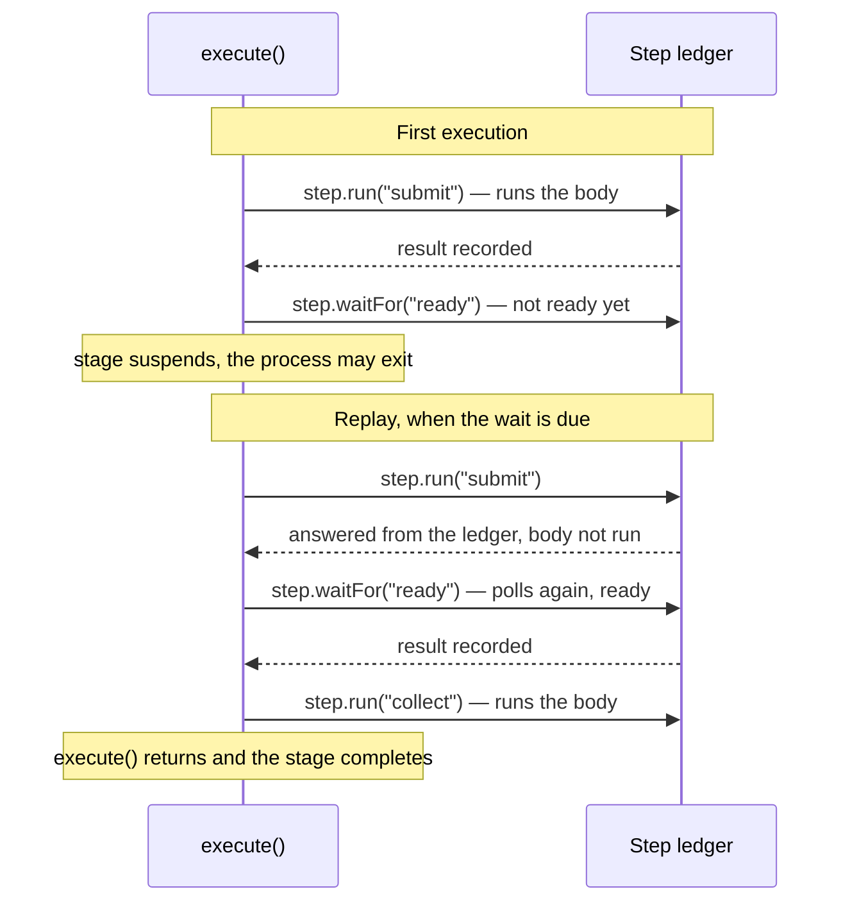

# Durable Steps

A stage checkpoints at its boundary: its output is written once, when `execute()` returns. Durable steps checkpoint *inside* a stage. Side effects run inside named steps whose results are stored in a **step ledger** (the `workflow_steps` table), and a suspended or crashed stage resumes by re-running `execute()` from the top with every completed step answered from the ledger instead of executed again.

That is what lets one linear function submit a batch, wait hours for it, sleep, and wait for a human — and survive the process dying at any point in between.



---

## Setup

The kernel needs a `StepLedger`; `ctx.ai` additionally needs AI services:

```typescript
import { createKernel } from "@bratsos/workflow-engine/kernel";
import {
  createPrismaAICallLogger,
  createPrismaStepLedger,
} from "@bratsos/workflow-engine/persistence/prisma";

const kernel = createKernel({
  // ...persistence, blobStore, jobTransport, eventSink, clock, registry
  stepLedger: createPrismaStepLedger(prisma),
  services: { aiLogger: createPrismaAICallLogger(prisma) },
});
```

The Prisma ledger uses the `WorkflowStep` model from [Prisma Setup](../persistence/prisma-setup.md). In tests, `InMemoryStepLedger` from `@bratsos/workflow-engine/testing` — or simply `createTestHarness()`, which wires it — does the same job. A stage that never touches `ctx.step` runs without a ledger; touching it unconfigured throws `StepLedgerNotConfiguredError`.

`blobStore` must be shared by every process that executes or polls a run: a replay resolves `ctx.input` and `ctx.require(...)` from it on every poll.

---

## The step API

```typescript
interface StepApi {
  run<T>(id: string, fn: (step: StepRunContext) => Promise<T>, options?: StepRunOptions): Promise<T>;
  waitFor<T>(id: string, opts: StepWaitOptions<T>): Promise<T>;
  waitForSignal<T = unknown>(id: string, opts: StepSignalOptions): Promise<T>;
  sleep(id: string, duration: number | string): Promise<void>;
  readonly ai: StepAiApi; // generateText / generateObject / streamText / map
}

interface StepRunOptions {
  lease?: number | string;        // held while fn runs; default 5 minutes
  retries?: number;               // retries after the first failed attempt; default 0
  retryDelay?: number | string;   // delay before a retry; default 0
  retryIf?: (error: unknown, info: { attempt: number }) => boolean; // false = do not retry this error
  retryBackoff?: {                // grow retryDelay per failed attempt
    factor?: number;              //   delay(n) = retryDelay * factor^(n-1); default 1
    maxDelay?: number | string;   //   cap on the computed delay
    jitter?: boolean;             //   wait a uniform random fraction of it (full jitter)
  };
  heartbeat?: number | string | false; // auto-extend the lease on this interval; default false
  onReclaim?: "rerun" | "fail";   // what a lease-expiry takeover does; default "rerun"
  leaseMs?: number;               // deprecated alias of `lease`
  retryDelayMs?: number | string; // deprecated alias of `retryDelay`
}

interface StepRunContext {
  readonly stepId: string;
  readonly externalKey: string;   // stable name for this body's external effect
  readonly attempt: number;       // 1 on the first execution
  readonly isReclaim: boolean;    // an earlier execution of this body may have run
  heartbeat(): Promise<void>;     // extend the lease by `lease` from now
  readonly abortSignal: AbortSignal; // same object as ctx.abortSignal
}

interface StepWaitOptions<T> {
  poll: () => Promise<T>;
  ready: (value: T) => boolean;   // may be a type guard; the result narrows
  every: number | string;         // "30s", "5m", or milliseconds
  timeout: number | string;       // non-sliding deadline from the first wait
  pollBackoffMs?: number;         // backoff after poll() throws; default = every
}

interface StepSignalOptions {
  timeout: number | string;       // non-sliding deadline from the first wait
  keepalive?: number | string;    // re-suspend interval while no signal; default 5m
}
```

Every duration takes milliseconds or a string (`"30s"`, `"5m"`, `"24h"`). `lease` and `retryDelay` are the canonical names; `leaseMs` and `retryDelayMs` still work and the canonical name wins when both are given. `lease` and `heartbeat` end up in timers (a heartbeat interval; the wait for in-flight steps before a suspension), so each must be a number of milliseconds from `1` to `2147483647` (the longest delay a timer honours, about 24.8 days): anything else (`0`, a fraction below 1, `NaN`, `Infinity`, a negative number, `"25d"`) throws a `RangeError` that names the option before the step is claimed.

```typescript
const render = defineStage({
  id: "render",
  name: "Render",
  schemas: { input: In, output: Out, config: z.object({}) },
  async execute(ctx) {
    const job = await ctx.step.run("submit", () => renderApi.submit(ctx.input));

    const status = await ctx.step.waitFor("poll", {
      poll: () => renderApi.status(job.id),
      ready: (s) => s.state === "done",
      every: "30s",
      timeout: "6h",
    });

    await ctx.step.sleep("settle", "10s");

    const approval = await ctx.step.waitForSignal<{ approved: boolean }>("approve", {
      timeout: "7d",
      keepalive: "1h",
    });

    return { output: { url: status.url, approved: approval.approved } };
  },
});
```

- **`run`** executes `fn` once and stores its result.
- **`waitFor`** calls `poll` and, while `ready` is false, suspends the stage; the host's maintenance tick replays it after `every`.
- **`waitForSignal`** suspends until something completes the step with the `step.signal` command — or an operator does it from the [console](../console/overview.md):

  ```typescript
  await kernel.dispatch({
    type: "step.signal",
    workflowRunId,
    stageId: "render",
    stepId: "approve",
    payload: { approved: true },
  });
  // → { ok: true, signalled: true, alreadyCompleted: false }
  ```

  Signalling twice is a no-op (`alreadyCompleted: true`); signalling a timed-out step is rejected.
- **`sleep`** suspends for the duration.

Suspension is a thrown control-flow error (`StepSuspend`, or `StepInFlight` when another worker holds a lease). The stage factory turns it into a suspended stage record, and `stage.pollSuspended` replays `execute()` on the next tick.

### Signal keepalive

If the signal ledger write succeeds but waking the stage fails, retry `step.signal`. The completed signal keeps its first payload; the retry finishes the stage wake and records one `step:signalled` event. A replay after a successful wake has no further effect. The wake is recorded per ledger row (completion time, creation time, position and attempt), and the ledger reset of an explicit `job.execute` re-run releases the claim of every signal row it drops, once the clear has committed, so a signal that completes a new row after that reset wakes the stage again even when its timestamp equals the earlier one. Limits: the release happens only on that reset. A reset by a host still on an earlier release during a rolling deploy, and a `run.redrive` on a ledger without `clearExcept` (it drops completed signal rows without releasing their claims), can still lose the wake of a second signal whose row has the same timestamp, creation time, position and attempt.

A signal wait re-suspends every `keepalive` (default five minutes, never later than `timeout`) while nothing has arrived. That interval does **not** set signal latency: `step.signal` moves the stage's `nextPollAt` to now, so a landed signal wakes the stage on the host's next tick whatever the keepalive is. What it bounds is how long a *lost* nudge — a host that was down when the signal landed — can delay the wake, and each keepalive costs one replay of the stage body up to the wait. Raise it for a wait measured in days; lower it only when the host that would receive the nudge is unreliable.

---

## Leases, retries and deadlines

- A `run` step holds a **lease** while `fn` runs. If the worker dies, the next replay re-claims the step once the lease expires, increments `attempt`, and runs `fn` again. A live lease suspends the replay as `StepInFlight` instead of running `fn` twice.
- **The lease is what a crash costs you in latency.** A ledger row records no worker identity, so the lease is a step's only liveness signal, and nothing may release it early without risking a second execution of `fn`. With the default of five minutes, recovery of an interrupted step is up to five minutes behind the crash. Set `lease` per step to the longest you expect `fn` to take plus headroom: `{ lease: "30s" }` recovers in about 30 s.
- **A body that outlives its lease can heartbeat.** `step.heartbeat()` pushes the lease out by `lease` from now, under a compare-and-set pinned to this execution's `attempt`; call it between units of work you cannot bound up front. `heartbeat: "30s"` in the options does the same on a timer while `fn` is pending (the interval must be shorter than the lease). When the row is no longer this execution's — its lease lapsed and a replay took the step over — `heartbeat()` rejects with `StepLeaseLostError`, and the body should stop: its outcome would lose the same compare-and-set.
- **`retries`** makes a thrown `fn` retryable: the failure is recorded, the stage suspends for `retryDelay`, and the next replay re-runs `fn`. When retries are exhausted the stored error is thrown and that stage attempt fails; while the stage's job has attempts left the stage is retried like any other throw, and each retry runs the step once more. **`retryBackoff`** grows the delay: after failed attempt *n* the wait is `retryDelay * factor^(n-1)`, capped at `maxDelay`, and `jitter: true` waits a uniform random fraction of it. `{ retries: 3, retryDelay: "10s", retryBackoff: { factor: 2, maxDelay: "30s" } }` waits 10 s, 20 s, 30 s. The delay is computed from the `attempt` stored on the row, so a retry replayed by another process computes the same delay.
- **A step retries every error except `NonRetryableError`.** A Zod error from a response the body validates is retried like any other. Throw `NonRetryableError` (exported from `@bratsos/workflow-engine`, with the original as `cause`) when retrying cannot help, or pass **`retryIf`** to decide per error: it is called synchronously with the error and the step `attempt` (1 on the first) every time the body throws anything but a `NonRetryableError`. Returning `false` stops the step's own `retries`, and the stage sees a `NonRetryableError` with the original as `cause`, so its attempt fails terminally. Any other return value leaves `retries` in charge, and so does a predicate that throws (a throw or an object return is logged). A predicate that returns or throws a Promise breaks its synchronous contract: the engine attaches a no-op handler to a plain native Promise where it can, and if that Promise rejects and the engine cannot attach a handler, the rejection is the application's own unhandled rejection, as anywhere else in stage code. Neither changes when a step that failed is run again by anything else: a stage retry re-opens failed steps and `onReclaim` decides a takeover, exactly as before. During a rolling deploy: A terminal verdict (`NonRetryableError`, a `retryIf` that returns `false`) is honoured once every host runs this release. A host still on an earlier release that recovers a job (after a lost lease or a lost failure acknowledgement) runs it as that release does: it can run the body again, even past the queue's budget, which limits only the decision to schedule another retry, so completed steps and provider calls can run again. The dead-job end after a lost acknowledgement requires the recovering host to include the FAILED-stage handling of #83 (on main since e44baf8), not this release.
- **A replayed step failure is classified as on main.** The ledger row of a failed step holds the message and nothing else. A replay that meets it rebuilds a plain `Error` with that message (or `StepTimeoutError` when the message is that step's timeout text), with no brand, so a `NonRetryableError` or a `retryIf` refusal is terminal only in the execution that threw it. A replay with `retries` left runs the body again, as it always has.
- **Wait deadlines never slide.** `waitFor` and `waitForSignal` compute `timeout` once, when the wait is first recorded, and store it on the row; past it the step is marked failed and the stage fails with `StepTimeoutError`.
- **A throwing `poll` does not fail the stage.** The stage suspends for `pollBackoffMs`; the first three consecutive failures are logged at DEBUG (batch providers are eventually consistent right after a submit) and the streak escalates to WARN from the fourth. A poll that returns resets the count.
- A stage still waiting on the same step re-suspends silently on every poll: `stage:suspended` / `workflow:suspended` are emitted when the wait starts and again only when the stage moves on to a different step.
- If `fn` succeeded but the ledger write failed, `run` throws `StepLedgerWriteError` rather than recording a failure, because the side effect already happened.

---

## Non-idempotent external calls: `externalKey` and `onReclaim`

Re-running `fn` is safe when `fn` is safe to repeat. It is not when `fn` creates something a provider bills or a third party sees. The dangerous window is unavoidable: the worker dies *after* the call took effect and *before* the ledger recorded it; the lease expires, the replay re-claims, and `fn` runs again.

**`step.externalKey`** is derived from the stage record id and the step id (`wfe-` plus a 128-bit hash, 36 characters of `[a-z0-9-]`), so it is identical on every replay, and it is written to `workflow_steps.externalKey` *before* the body runs:

```typescript
const charge = await ctx.step.run("charge", async (step) => {
  // 1. Send it where the provider dedupes on it.
  return stripe.charges.create({ amount, currency: "usd" }, { idempotencyKey: step.externalKey });
});

const job = await ctx.step.run("submit", async (step) => {
  // 2. After a crash, look for the effect before making it.
  if (step.isReclaim) {
    const existing = await renderApi.findByTag(step.externalKey);
    if (existing) return existing;
  }
  // 3. Stamp it so the search above can work.
  return renderApi.submit({ ...input, tag: step.externalKey });
});
```

`step.isReclaim` is true only when an earlier execution of this body may already have run; on a clean first execution `attempt` is `1` and `isReclaim` is `false`. Because the key is derived, an operator can read it out of the `workflow_steps` row (the console shows it on `run` steps) and search the provider without the process that made it.

**`onReclaim: "fail"`** is for a body whose effect can be neither deduplicated nor found. Instead of re-running it after a lease expiry, the engine fails the step with `StepNotReplaySafeError`, naming the step, the time its lease expired and its external key:

```typescript
await ctx.step.run("wire-transfer", () => bank.send(order), { onReclaim: "fail" });
```

The default is `"rerun"`. `onReclaim` governs the lease-expiry takeover only; it does not affect `retries`. A body that threw runs again while it has `retries` left, even when the provider accepted its effect before the throw (a lost response, for example). Give such a body `retries: 0`, or have it look its external key up before it acts.

### When two workers reach the same step

A step's outcome is recorded with a compare-and-set against the row still being open: first write wins, and the loser parks on the outcome already recorded. Both callers are answered the same value. When that happens the engine logs a WARN and writes a `step.outcome-conflict` annotation on the run (step id, kind, recorded status, attempt, `externalKey`). It is a report, not a failure: what it tells you is that the body ran more than once, which is when a duplicate external effect is possible.

**A `ctx.step.ai.map` submit step is the exception.** Its row (`${id}:submit`) can be held by a `run.cancel` sweep, which takes it over at `attempt + 1` and writes its fence, cancel intent and tombstone into the row. So an execution of a submit body records its outcome (success, failure, cancellation) only while the row is still open at the attempt it claimed. A body whose lease lapsed and whose row was taken over (by a replay or by a sweep) does not record anything: when the row has an outcome it parks on it as above, and when the row is still open under another attempt it throws `StepLeaseLostError`. The batches it created that the row does not list are then cancelled: first recorded in the row (`cancelledBatchIds`, so they are never adopted) when nothing holds it, cancelled without a write when a sweep holds it, and cancelled directly when the row is gone with its stage record. When another live execution holds the row, they are left for it to adopt by the external key, with a WARN naming the batch ids, on a transport that can search for them (OpenAI, Gemini). On one that cannot (Anthropic, OpenRouter) the other execution never lists them, so they are cancelled. Other `run` steps keep first write wins.

---

## Cancellation and lost leases: `ctx.abortSignal`

`run.cancel` marks the run `CANCELLED`, purges the queue and cancels the provider batches the run created (see [Batch Operations](../ai/batch-operations.md#cancelling-a-run)); the job executing at that moment has its outcome discarded when it finishes. Without a signal that is all that happens — a body in the middle of a ten-minute model call runs to completion for nothing. `ctx.abortSignal` is that signal: an `AbortSignal` on the stage context, and the same object as `step.abortSignal` inside every `run` body (named `abortSignal`, not `signal`, so it is not confused with `waitForSignal`).

```typescript
async execute(ctx) {
  const draft = await ctx.step.run("draft", (step) =>
    ctx.ai.generateText("gemini-2.5-flash", prompt, { abortSignal: step.abortSignal }),
  );
  const res = await fetch(url, { signal: ctx.abortSignal });
  // ...
}
```

It is aborted from the host's job lease heartbeat (`job.heartbeat`, every `jobHeartbeatIntervalMs`, default 60 s), so the latency is one heartbeat interval. `abortSignal.reason` is a `StageAbortedError` whose `reason` is:

- **`"cancelled"`** — the run is `CANCELLED`. No `run` body starts once the signal reports this: `ctx.step.run`, and every step built on it (`ctx.step.ai.*`), throws the `StageAbortedError` before the body and writes no row, so a redrive does not count the step as an attempt; a step that already completed still answers from the ledger. A body that was already running and finishes after this is recorded as `failed` with the cancellation as its error, not as completed; no retry is spent. `waitFor` checks the signal before it calls `poll`.
- **`"lease-lost"`** — the job lease was released (a stale-lease reap, the absolute cap) or re-claimed by another worker. Another worker may already be executing the same stage. A `run` body that finishes after this *is* still recorded — the step row's own lease and compare-and-set decide the owner.

`stageAbortReason(signal)` returns the reason or `undefined`. A context built without a host loop (a direct `job.execute` dispatch, a `stage.pollSuspended` replay, a remote activity worker) carries a signal that never fires. Honouring it is optional: the engine discards a cancelled invocation's result either way.

---

## Concurrency

Steps may run concurrently under `Promise.all`:

```typescript
const [profile, , invoices] = await Promise.all([
  ctx.step.run("profile", () => api.profile(id)),
  ctx.step.waitFor("export", { poll, ready, every: "30s", timeout: "1h" }),
  ctx.step.run("invoices", () => api.invoices(id)),
]);
```

When `export` suspends, the stage factory waits for every in-flight `run` to settle and record — bounded by the longest remaining lease — before the suspension is persisted, so the replay finds completed rows rather than live leases. Ids must still be unique within the invocation, and keep the array literal stable so replays line up.

---

## Determinism rules

- **Side effects only inside steps.** Everything outside `ctx.step.*` runs again on every replay. Reading `ctx.input`, `ctx.require(...)` and building prompts is fine; calling an API outside a step is not.
- **Stable, unique ids.** A step is keyed by `(stageRecordId, stepId)`, not by position, which is what lets a run survive renaming and reordering the code around a step. Derive ids from data (`item-${doc.id}`), never from `Math.random()` or the clock. Asking for the same id twice in one invocation throws `DuplicateStepKeyError` (recognisable across bundles with `isDuplicateStepKeyError`); it is a programming error, so the stage fails terminally without consuming retry attempts.
- **Never swallow step errors.** A `try/catch` around `ctx.step.*` must rethrow, or check `isStepControlFlowError(error)` and rethrow those. If a catch swallows one anyway, the stage factory discards the returned value and suspends, logging one warning.
- **Results are JSON, and small.** `run` results round-trip through JSON (Dates become strings, `undefined` fields disappear). A result whose JSON exceeds `spillThresholdBytes` (default 64 KiB) is written to the blob store behind a claim check rather than rejected — see [Kernel and Ports](./kernel-and-ports.md#large-payloads-the-claim-check) — but a body that downloads a document should still write it with `ctx.storage` and return the key.
- **Order warnings.** Each step gets a sequence number when first created. A replay that reaches a known step at a different position logs a warning that the body is no longer deterministic; fix the body rather than the warning.

### Which rows survive what

- **A job retry replays the ledger and re-opens what failed.** A body that throws after some steps completed is retried by the job queue (up to the transport's `maxAttempts`); the failed attempt is recorded as `PENDING` with `stage:retrying` emitted, the ledger is kept, and the retry replays it. Every `run` step and map item that ended `failed` is re-opened, so it executes again rather than replaying a stored failure; completed steps are never re-run. The row's `attempt` keeps counting across job attempts. A replay of a suspended stage that throws (a failed commit, ledger or blob write, or a body error) is retried the same way by `stage.pollSuspended`, within the attempts the job has left; a `NonRetryableError`, a Zod error, an expired wait, an `onReclaim: "fail"` refusal and a `DuplicateStepKeyError` still fail the stage at once.
- **A redrive keeps the resumed stage's progress.** `run.redrive` with `lastFailure` or `stage` reopens the resumed stage in place, so every completed row is answered from the ledger and its external key is unchanged; only `start`, and the stages after the resumed one, delete the record and clear its ledger — with every dropped row that names an external effect recorded first. See [Retry, Restart and Rerun](./redriving-runs.md).
- **Re-running a terminally failed stage keeps a live batch handle.** Executing a `FAILED` stage on purpose (a `job.execute` dispatched without `attempt`, the way a caller asks for a re-run) re-opens every `run` row carrying an `externalKey` (back to `running` with no lease, body told `isReclaim: true`; a completed one runs again too) instead of deleting it, so a submit re-adopts the batch a provider is still processing. Everything else, waits, signals and sleeps and rows without an external key, is dropped: waits, signals and sleeps hold only timers. A job a host delivers again after its stage failed is not such a re-run: it ends with the stored error and runs no step, so a completed step with an external key is never executed twice by a redelivery. To run a failed stage again, redrive the run. The partial clear is the optional `StepLedger.clearExcept`; a ledger without it falls back to a full clear and the kernel logs every external key it is about to drop.

---

## `ctx.step.ai`

Durable AI calls are `ctx.ai.*` wrapped in `step.run`: on replay a completed call returns its stored result (`text` or `object`, tokens, cost, reasoning — not the raw SDK object) without contacting the model.

```typescript
const summary = await ctx.step.ai.generateText("summary", "gemini-2.5-flash", prompt);
const facts = await ctx.step.ai.generateObject("facts", "gemini-2.5-flash", prompt, FactsSchema);
```

Both take a trailing `stepOptions?: StepRunOptions`, forwarded to the underlying `step.run`, so one model call retries durably like any other step:

```typescript
const summary = await ctx.step.ai.generateText(
  "summary",
  "gemini-2.5-flash",
  prompt,
  { maxTokens: 2000 },
  { retries: 2, retryDelay: "30s", lease: "2m" },
);
```

`ctx.step.ai.streamText(id, model, prompt, options?, stepOptions?)` streams through `ctx.ai.streamText` on the first execution (forwarding `onChunk`) and stores the final text, tokens, cost and reasoning as one `run` step; a replay returns the stored `StepStreamResult` and calls `onChunk` once with the whole text. Use it where a host kills an idle non-streaming connection.

`ctx.step.ai.evaluate(id, model, { state, questions })` answers typed questions with a decision model such as TypeSafe's Jev and memoises the answers. This matters more than for text: a decision usually picks the branch the rest of the stage takes, so a stage that replays after a suspension must not ask again and possibly get a different answer halfway through work done under the first one.

```typescript
const { answers } = await ctx.step.ai.evaluate("route", "typesafe/jev-1.13", {
  state: { ticket: ctx.input.ticket },
  questions: {
    team: {
      type: "choice",
      instructions: "Which team should handle `ticket`?",
      criteria: { billing: "Charges and refunds.", engineering: "Bugs and outages." },
    },
  },
});
if (answers.team.choice === "engineering") { /* ... */ }
```

`ctx.step.ai.transcribe(id, model, audio)` transcribes audio (bytes, base64 or a `URL`) as one `run` step, so a replay neither re-sends the audio nor pays for it again. Only the transcript is stored, never the audio.

```typescript
const transcript = await ctx.step.ai.transcribe(
  "transcript",
  "whisper-1",
  new URL(ctx.input.audioUrl),
);
```

Both take step options (`retries`, `lease`, ...) as their last argument, like the other `ctx.step.ai` calls. See [AI Integration](../ai/overview.md) for the models and cost of each.

`ctx.step.ai.map(id, items, spec)` runs one prompt per item under a realtime or batch policy with the same schema validation and repair on both paths — that is the replacement for the 0.x async-batch stage, and it has its own page: [Batch Operations](../ai/batch-operations.md).

---

## Testing a durable stage

`createTestHarness()` from `@bratsos/workflow-engine/testing` gives you the kernel, the ledger, the mock AI factory and a driver loop, plus `harness.steps.mockResult` / `mockError` / `mockTimeout` / `skipSleeps` to decide a step's outcome before the run and `harness.cancel()` to exercise `ctx.abortSignal`. See [Testing Workflows](../testing/testing-workflows.md).
