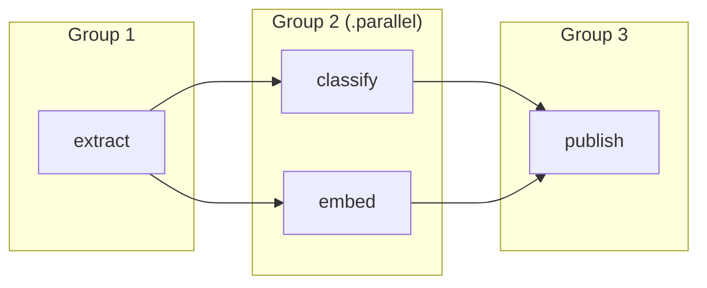
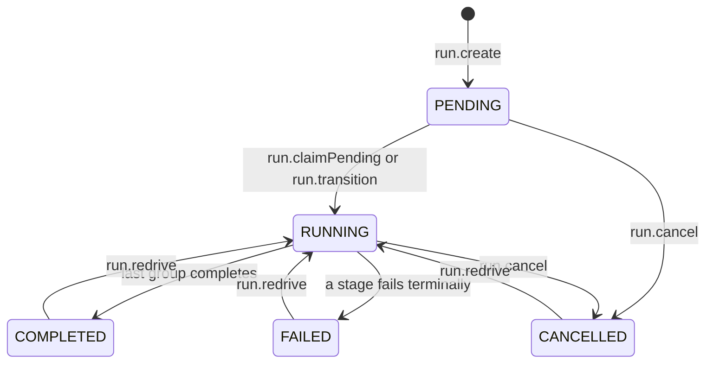
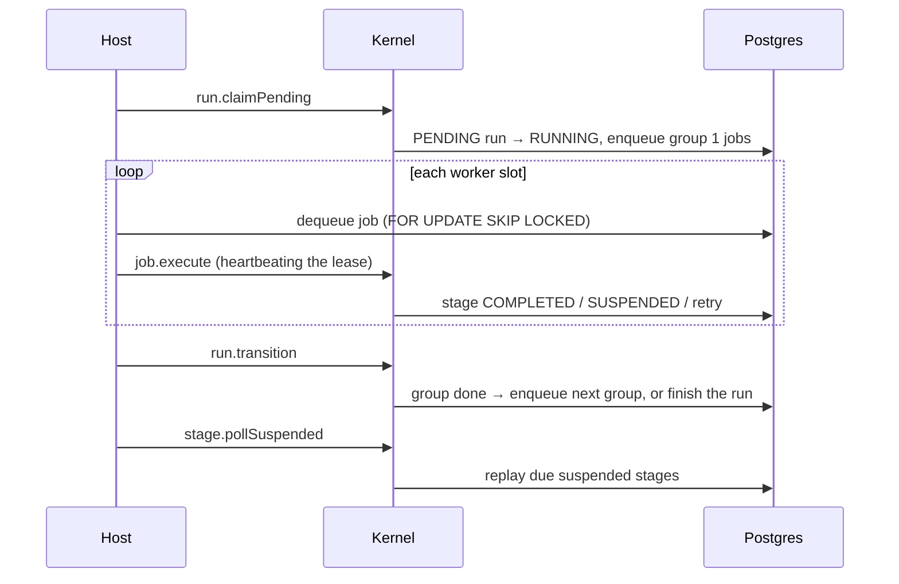

# Execution Model

**workflow-engine** uses a distributed, database-native execution model built for reliability, self-healing, and low operational overhead.

---

## Checkpointing at Stage Granularity

Instead of continuously recording execution state at the CPU/instruction level (which makes hosting complex and environment-dependent), **workflow-engine** checkpoints state at the boundaries of individual **Stages**.

* When a stage completes, its output is validated against its Zod output schema and written to the database (in the `WorkflowStage` record) as a single transaction.
* If a worker crashes or a stage fails, the workflow does not need to restart from the beginning. It resumes from the last completed stage.
* This makes it easy to run heavy, multi-stage pipelines on cheap, ephemeral instances (like spot instances or serverless functions).

Inside a stage, [durable steps](./durable-steps.md) add a finer checkpoint: each `ctx.step.*` call records its outcome in the step ledger (`workflow_steps`), and a crashed or suspended stage resumes by replaying `execute()` with completed steps answered from the ledger rather than re-running the whole stage body.

---

## Execution Groups

Workflows consist of an ordered list of **Execution Groups**:
* A sequential stage added via `.pipe()` gets its own execution group.
* Multiple concurrent stages added via `.parallel()` reside in the same execution group.
* The engine guarantees that all stages in execution group $N$ must reach a terminal state (`COMPLETED` or `SKIPPED`) before any stage in execution group $N+1$ can be claimed and executed.

A run moves through these statuses. `SUSPENDED` belongs to a stage, not a run: while a stage waits, its run stays `RUNNING`.

Every start of a run writes exactly one `workflow:started`, in the transaction that moves the run to `RUNNING` and before the run's first `stage:*` event. `run.claimPending` writes it for a run it claims. A `run.transition` of a `PENDING` run that no host has claimed yet starts it the same way (it sets `RUNNING`, creates the first group's stage records, queues their jobs and writes the event), and a `run.claimPending` after that finds nothing to claim. Each `run.redrive` (and the deprecated `run.rerunFrom`) writes one more, after the run's end. Releases before this fix left such a run `PENDING` after the transition, and the claim wrote a second `workflow:started`.

---

## Job Queue and Claiming

Jobs are queued in the `JobQueue` table. Polling is coordinated directly through database queries:
* **PostgreSQL lock avoidance**: The engine uses `FOR UPDATE SKIP LOCKED` to dequeue jobs, so multiple host processes can claim safely without double-claiming jobs.
* **SQLite claiming**: The engine uses transaction-based compare-and-set operations. Keep a SQLite file to one host process; multiple processes sharing the file are not a supported deployment.
* **Orchestration ticks**: Hosts run periodic orchestration ticks that look for runs in `PENDING` status, claim them, and queue their initial stages as jobs in the `JobQueue`.

---

## Leases & Heartbeats

To prevent jobs from hanging indefinitely when a worker crashes mid-execution:
* **Job Leases**: When a worker claims a job, it locks it with a lease (`lockedAt`).
* **Heartbeating (v0.11+)**: While a worker is executing a job, the host periodically heartbeats the job to extend its lease. The default stale lease threshold in `v0.11` is **300,000 ms (5 minutes)** (increased from 60 seconds in `v0.10` to prevent premature lease timeouts during heavy local CPU execution).
* **Lease Reaping**: The `lease.reapStale` command periodically searches the `JobQueue` for active leases that haven't been updated within the threshold, releases them, and marks them for retry. This runs automatically on each host orchestration tick. On PostgreSQL the lease runs on the database clock (`now()` at claim, heartbeat and sweep), so a host whose system clock is skewed cannot reclaim a job that was only just claimed.
* **Absolute cap**: The heartbeat only detects a worker that *stopped*; a worker that is alive but wedged keeps heartbeating forever. `jobAbsoluteTimeoutMs` (host option, default one hour, `0` disables) is measured from `startedAt`, which no heartbeat refreshes, and fails such a job terminally rather than requeueing it. Both sweeps stamp `lastError` with a distinguishable prefix: `LEASE_HEARTBEAT_LOST` (requeued) or `LEASE_ABSOLUTE_CAP` (failed).
* **Durable step leases** are separate from job leases and are deliberately *not* reaped: a `ctx.step.run` body holds a `lease` (default five minutes) that only its own expiry releases, because a ledger row carries no worker identity. See [Durable Steps](./durable-steps.md#leases-retries-and-deadlines).

### Suspended-stage single flight

A suspended stage is claimed by a different mechanism: the poller bumps the stage's `nextPollAt` to `now + max(pollInterval, 60s)` under a version-guarded compare-and-set. A second poller's guarded write touches zero rows and it skips the stage. Every outcome branch writes `nextPollAt` explicitly afterwards, so the lease value survives only when the process dies mid-replay -- in which case the stage waits out the lease and the next poller takes it.

**Why not a Postgres advisory lock?** A session-level advisory lock would release the moment the connection died, closing that window with no lease to tune. It was evaluated and rejected, for four independent reasons:

1. **Connection pooling.** The lock must span the `checkCompletion()` HTTP call and the transaction after it, so it has to be a *session* lock (`pg_advisory_xact_lock` releases at `COMMIT`, mid-replay). Session locks are re-entrant within a session, so two pollers handed the same pooled connection both win `pg_try_advisory_lock` on the same key -- single flight fails exactly where concurrency is highest.
2. **PgBouncer in transaction mode** does not support session-level advisory locks. Statements land on different server connections and the lock leaks with nothing to release it.
3. **The serverless host** has no long-lived connection to own a session lock, so it would need the `nextPollAt` lease as a fallback anyway.
4. **Row-level security.** This is the decisive one. If you run the kernel inside your own transaction (`skipInteractiveTransactions`, your `tx` client, `SET LOCAL` for your tenant), a session lock taken inside that transaction is *not* released at your `COMMIT` -- it leaks into your pooled connection. And the advisory namespace is one 64-bit integer space, global to the database and invisible to RLS: a tenant blocked on another tenant's key sees that key in `pg_locks` and waits on it, with no policy able to intervene. Row-level security cannot scope a lock it cannot see.

`Persistence` also has no raw-SQL escape hatch and SQLite has no advisory locks, so the port would have grown a Postgres-only optional method whose fallback was the lease regardless.

---

## Retries & Error Taxonomy

When a stage fails (by throwing an error), the engine increments the attempt count.

### Retry Mechanics
* The job is returned to the queue if `attempt < maxAttempts` (the transport's `maxAttempts` is the retry budget; the built-in transports back off `2^attempt` seconds). The stage row stays `PENDING` with the error on `errorMessage`, `stage:retrying` is emitted, and the stage's durable step ledger is kept: the retry replays completed steps and re-opens failed ones.
* The backoff strategy is managed by the host.
* A suspended stage that throws while `stage.pollSuspended` replays it is retried under the same rule and with the same classifier, spending the attempts its `SUSPENDED` job row has left. The stage stays `SUSPENDED` with the error on `errorMessage`, `attempt` is bumped, `stage:retrying` is emitted and the next poll replays it after a `2^attempt` second backoff; the same single-flight claim applies to that replay as to any other.
* A `checkCompletion` that **throws** fails the stage and the run on that poll, whatever the error: it is not retried. A `checkCompletion` that returns a non-empty `error` string fails it the same way; an empty one is ignored. Catch a transient provider error inside `checkCompletion` and return `{ ready: false }` to poll again. A store or blob error while the engine persists a `checkCompletion` answer (a failed commit, the output write) is not `checkCompletion`'s: it is retried under the same rule as a replay that throws, spending the attempts the stage's `SUSPENDED` job row has left. The stage stays `SUSPENDED` with the error on `errorMessage`, `attempt` is bumped, `stage:retrying` is emitted and the next poll asks `checkCompletion` again after a `2^attempt` second backoff. Once the attempts are spent, or the error is deterministic, the stage and the run fail with the store's error. A poll that persists its answer ends the streak, so only consecutive failures count.

### Which errors are retried
One classifier decides, wherever a stage throw is retried: `job.execute` (through the local executor) and a replay in `stage.pollSuspended`. It is the one earlier releases used, plus one brand. These fail the stage attempt terminally, whatever budget is left:
* a value carrying the `NonRetryableError` brand (exported from `@bratsos/workflow-engine`; `isNonRetryableError` detects it across bundled copies): a `NonRetryableError` thrown by the stage or by a step, one made by a step's `retryIf` returning `false`, and an expired durable wait (`StepTimeoutError`) or an `onReclaim: "fail"` refusal (`StepNotReplaySafeError`) as the execution that records it throws it. The brand is one symbol property, read after the checks below;
* a Zod error of the engine's own zod, and a `DuplicateStepKeyError`, as before.

The engine reads no name, message, cause or other field of a thrown value to classify it. A remote worker reports `retryable: false` for the brand alone (see [Remote workers](../hosts/remote-workers.md)).

The classifier sees errors thrown in the current execution. A durable step failure replayed from the ledger is rebuilt from its message, as before, so it is retried within the budget (a later attempt can consume a remaining step retry and complete). One exception is unchanged: `stage.pollSuspended` fails the stage at once on a `StepTimeoutError` or `StepNotReplaySafeError` of this engine copy, branded or not, including a timeout rebuilt from a step's stored timeout text; an instance from another copy goes through the classifier. A terminal verdict ends the job exactly as an exhausted final attempt does: the stage is FAILED, the queue row fails, the run fails, and a later delivery of the job (a lost acknowledgement, a lost lease) meets that FAILED stage and, on a host that includes #83's FAILED-stage handling, ends as a dead job with the stored error, exactly as after an exhausted final attempt: no step runs again and no retry is scheduled.

Every other error is retried within the budget. `job.execute` records the error as `"Name: message"` through the local executor (a plain `Error` by its message alone) and as the bare message a remote worker reports; `stage.pollSuspended` records the message of an `Error`, and any other value as `String` converts it (a decoded object reads `[object Object]`).

### Terminal Failures
Once a stage exhausts its `maxAttempts`, it is marked as `FAILED` and `stage:failed` is emitted.
* A terminal stage failure triggers `run.transition` **immediately** within the same database transaction. The parent workflow run is failed with the stage's error right away, rather than waiting for the next orchestration poll.
* **A job delivered again after its stage is `FAILED` is a dead job.** If the host loses the acknowledgement of the final attempt (a crash before `jobTransport.fail`, a lost lease, a delivery past `maxAttempts` such as attempt 3 of 2) or of a deterministic failure, the queue delivers the job again. `job.execute` answers that delivery with `outcome: "failed"`, the stored error and `willRetry: false` before it starts anything: no step body runs (a completed receipt is not repeated, whatever its `onReclaim`), the stage and its ledger are not reset, and no stage event is written. The host fails the job and the run fails once with the stage's error. To run a failed stage again, redrive the run ([Retry, Restart and Rerun](./redriving-runs.md)); a retry within the budget after a retryable failure is a different path, because that stage is `PENDING`, not `FAILED`. A host passes the job's `attempt` and `maxAttempts`; a `job.execute` dispatched without `attempt` is treated as an explicit rerun of a `FAILED` stage and starts it again.
* **Only the attempt that owns the stage commits.** The stage write that ends an attempt (completed, suspended, a retry or `FAILED`) is fenced on the stage version `job.execute` claimed when it started. The stage stays the attempt's while it is `RUNNING` under the same record, `attempt` and `startedAt`: another delivery after a lost lease stamps a strictly later `startedAt`, and a redrive, `run.rerunFrom`, a cancel or `run.reapStuck` changes the status or the attempt. A write that lost only to something else (a `step.signal` nudging `nextPollAt`) is repeated on the stored version; an attempt that was overtaken has its result discarded (`ghost: true`, `ghostReason: "orphan"`), so it can neither mark a reopened stage `FAILED` nor complete or fail the stage under the delivery that took it over. Output and artifacts are first saved under keys of the attempt's own (`<stage>/attempts/<id>/…`), which only the committed write points `outputData` at; a discarded attempt's keys are deleted afterwards, best-effort, unless some `outputData` points at them. After its write commits, the winner also copies its output to the stage's fixed key `workflow-v2/<type>/<run>/<stage>/output.json` (the default `ctx.storage.getStageKey(stageId)`) and each artifact to `<stage>/artifacts/<name>.json`, as every earlier release wrote them; a discarded attempt never writes them. The pointer (`workflowContext`, `loadWorkflowContext`) is what the engine reads and the one source a reader can rely on in every interleaving; the fixed keys are a best-effort, unfenced copy taken after the commit: an older winner's late copy can land after a newer winner's, so they can briefly lag, hold an older winner's bytes, or be missing (a failed copy is logged as a WARN on the run, and a later delivery that finds the stage COMPLETED while the run is still RUNNING copies `output.json` again, but not the artifact keys). What the body did itself (step rows, `ctx.storage`, `ctx.log`, external calls) is not undone.

### Ghost Job Guard
A **ghost job** occurs when a worker dequeues a job it must not execute. `job.execute` checks the parent run before and after stage execution and, when it is not something this worker should run, discards the result and returns `{ ghost: true, ghostReason }`:
* **`"orphan"`** — the run is no longer `RUNNING` (cancelled, or failed by another process). Hosts fail the job terminally without a retry, so no zombie loop.
* **`"race"`** — the run is still `PENDING`: the job became visible before the claim that created it committed. Hosts re-deliver it through the transport's normal backoff.
* **`"version"`** — the run is pinned to a definition version this build does not serve (see [Definition Versioning](./definition-versioning.md)). Hosts *defer* the job — back to `PENDING` with a delay and its attempt given back — for a host that can serve it. The run is not failed.

### Stuck Run Detection
If a run becomes stuck in `RUNNING` status (e.g., due to an unhandled worker crash and queue loss), the `run.reapStuck` command detects it.
* A run is deemed stuck if neither the run nor any of its stages have had database updates within the threshold (default: `max(3 * staleLeaseThresholdMs, 5 minutes)`).
* Stuck runs are automatically failed with the error code `STUCK_RUN_REAPED`.
* A `PENDING` stage whose job is missing (the process died between the commit and the enqueue) is re-enqueued instead of failing the run. The sweep also refreshes the run's activity, on every persistence backend, so the next sweep before a worker dequeues the recovered job does not reap the run. If that refresh loses to another writer, or the post-commit enqueue fails, the stage stays without a job until the sweep one threshold later.
* A run whose `SUSPENDED` stage has a `nextPollAt` that is still in the future, or became due less than one threshold ago, is not reaped: a long `ctx.step.sleep`, `waitFor` `every` or signal `keepalive` leaves the rows untouched for longer than the threshold without the run being stuck. A suspended stage with no `nextPollAt`, or one overdue by more than the threshold, is reaped as before.

---

## Authoritative Cancellation

Cancellation in **workflow-engine** is designed to cascade immediately through the system to prevent unnecessary API spending:
1. **Mark Run**: `run.cancel` sets the `WorkflowRun` status to `CANCELLED`.
2. **Cascade to Stages**: All non-terminal stage records in that run are updated to `CANCELLED` and their `nextPollAt` time is cleared. Each write is fenced on the stage version `run.cancel` read. A stage that another execution ended in the meantime (a `job.execute` that committed it `COMPLETED` first) keeps its outcome, and so do its events. A stage that moved without ending is read again and cancelled. On Postgres the fenced write waits for the other transaction and then finds the version moved; SQLite runs the two one after the other.
3. **Purge Job Queue**: Once steps 1 and 2 have committed, the run's queued and suspended jobs are cancelled in the job transport via `jobTransport.cancelByRun()`. This happens after the commit, not inside the transaction: the job transport works on its own connection, so inside the transaction every cancel held one connection and waited for a second, and a burst of cancels as large as the pool wedged it. In the window between the commit and the purge, a worker that dequeues one of the run's jobs finds the run `CANCELLED` and discards the job as an orphan (step 6), so that job ends `FAILED` rather than `CANCELLED`. If the purge itself fails, `kernel.dispatch` rejects with that error while the run stays `CANCELLED`; a `SUSPENDED` job then stays `SUSPENDED` until `run.purge`, and a second `run.cancel` returns `cancelled: false` without retrying the purge (it does retry the provider batch cancels of step 4 below). A `run.redrive` that lands between the cancel's commit and the purge is undone: `run.redrive` accepts a `CANCELLED` run, so the run ends `RUNNING` with its new job `CANCELLED`, and `run.reapStuck` re-enqueues the job later.
4. **Cancel Provider Batches**: After the same commit, the provider batches the run's `ctx.step.ai.map` steps created (and the ones a legacy async-batch stage listed in `suspendedState.metadata.batchRefs`) are cancelled at the provider, because a batch bills until it ends. The job purge is attempted first; the batch cancels are attempted even if it throws. A cancel that fails or cannot be sent never fails or undoes the cancel: the run ends `CANCELLED`, each batch is reported as `cancelled`, `already-terminal`, `unsupported`, `unavailable`, `failed`, `unrecorded` (a submit step holds no handle), `unverified` (the engine cannot prove it created the handle) or `held` (another `run.cancel` sweep holds the submit step, possibly one that stopped while holding it, until `heldUntil`: repeat `run.cancel` after then) in `result.batches`, and each one that may still be running is logged as a WARN on the run. `cancelled` keeps its meaning (`true` only for the command that moved the run to `CANCELLED`), so repeating `run.cancel` on a `CANCELLED` run answers `cancelled: false` and retries every provider cancel that did not take effect. A `FAILED` run keeps its batches, since `run.redrive` re-adopts a live one. The sweep is tied to the cancelled run generation: one held up past a `run.redrive` does nothing, and it holds each submit row (a lease) while it calls the provider so a replay cannot proceed with the handle it is cancelling. The provider calls are bounded: 30 seconds per batch and 60 seconds for the whole sweep, so `run.cancel` waits at most 60 seconds for providers (a batch not reached is reported as `failed`). The same sweep runs wherever a handler that executed a stage body then finds the run `CANCELLED` (the ghost exits of `job.execute` that follow a body, and a `stage.pollSuspended` replay whose stage the cancel moved or whose claim finds the run `CANCELLED`), because a body whose abort signal had not fired yet can create a batch after `run.cancel` read the ledger. See [Cancelling a run](../ai/batch-operations.md#cancelling-a-run) for the providers, the credentials a cancelling process needs, and redrive.
5. **Stop Active Work**: A worker executing a stage of that run learns about the cancellation from its job lease heartbeat (`job.heartbeat`, every `jobHeartbeatIntervalMs`): `ctx.abortSignal` — the same signal as `step.abortSignal` inside every `ctx.step.run` body — is aborted with a `StageAbortedError` whose `reason` is `"cancelled"`. Pass it to `fetch`, `ctx.ai.*` or anything else that can be interrupted. A `run` body that finishes after the abort is recorded as failed with the cancellation as its error, not as completed; no step body starts once the signal reports the cancel (it throws the `StageAbortedError` before the body and writes no row); and `waitFor` checks the signal before it polls. The same signal fires with reason `"lease-lost"` when the worker's job lease was released or re-claimed.
6. **Discard Active Work**: Whatever a cancelled stage still returns hits the **Ghost Job Guard** upon completion, ensuring its results are discarded and no further stages in that pipeline are queued.
