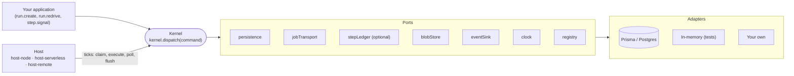

# Kernel and Ports

**workflow-engine** is designed around a **hexagonal (ports-and-adapters) architecture**. The core library exposes a pure, stateless **Command Kernel** that is completely isolated from side effects. It interacts with the outside world strictly through defined interfaces called **Ports**.

---

## Hexagonal Architecture Overview

By decoupling execution logic from infrastructure, the core engine has:
* **Zero global state**: All state belongs to the caller or the database.
* **Zero runtime timers/signals**: The kernel does not manage standard intervals or event loops.
* **Environment independence**: The exact same kernel can execute on Node.js, serverless edge workers, AWS Lambda, or in-memory unit tests.



The kernel never runs on its own. Hosts drive it with commands on a schedule, your code dispatches commands for the things only it knows about, and everything the kernel reads or writes goes through a port you supply.

---

## The Core Ports

When initializing a kernel with `createKernel`, you must inject implementations for six required ports — `persistence`, `blobStore`, `jobTransport`, `eventSink`, `clock`, and `registry`:

| Port Name | Interface | Purpose |
| :--- | :--- | :--- |
| **`persistence`** | `Persistence` | Manages metadata storage for runs, stages, execution logs, transaction outboxes, definition snapshots and idempotency records. |
| **`blobStore`** | `BlobStore` | Handles storage for large input/output payloads, intermediate stage artifacts and spilled step results (using methods like `put`, `get`, `has`, `delete`, and `list`). Must be shared by every process that executes or polls a run. |
| **`jobTransport`** | `JobTransport` | Acts as the job queue (managing dequeue loops, claiming, and cancelling queued jobs). |
| **`eventSink`** | `EventSink` | `{ emit(event) }` — receives system events (e.g., `workflow:completed`, `stage:started`) when the outbox is flushed. |
| **`clock`** | `Clock` | Resolves the current system time. Can be mocked in tests (`FakeClock`) to control duration math. |
| **`registry`** | `WorkflowRegistry` | Maps workflow IDs to their respective immutable `Workflow` objects. Build it with `createWorkflowRegistry([...])`: that implements the optional `listWorkflows()`, which is what lets a host claim only runs pinned to a definition version it can execute (see [Definition Versioning](./definition-versioning.md)). A hand-written `{ getWorkflow }` works but claims unfiltered. |

The optional ports and settings:

| Option | Type | Purpose |
| :--- | :--- | :--- |
| **`stepLedger`** | `StepLedger` | Storage for [durable steps](./durable-steps.md) (`InMemoryStepLedger`, `createPrismaStepLedger`). A stage that never touches `ctx.step` needs none; touching it unconfigured throws `StepLedgerNotConfiguredError`. |
| **`services`** | `{ aiLogger, ai? }` | Provides `ctx.ai` (an `AIHelper` built lazily per stage under the topic `workflow.<runId>.stage.<stageId>`) and `ctx.aiLogger`. `ai` is an optional factory with the signature of `createAIHelper`, for routing options, an adapter or timeouts in one place. Accessing `ctx.ai` without services throws `AIServicesNotConfiguredError`. |
| **`executor`** | `ActivityExecutor` | Delegates stage executions to separate processes or remote activity workers (see [Remote Workers](../hosts/remote-workers.md)). Defaults to the local executor. |
| **`spillThresholdBytes`** | `number` | Soft threshold above which a step result is written to the blob store behind a claim check (default 64 KiB); see below. |
| **`idempotencyStaleInProgressMs`** | `number` | How long an idempotency key may sit `in_progress` before a later dispatch may reclaim it (default 10 minutes). |

There is no `scheduler` port: `KernelConfig.scheduler` and `NoopScheduler` were removed in 1.0. Suspended stages are resumed by host-driven `stage.pollSuspended` polling — see [Command Dispatch](#command-dispatch) below.

---

## Command Dispatch

The kernel acts as a single command processor. Host runtimes interact with the kernel by calling `kernel.dispatch(command)`.

All operations are expressed as strongly-typed commands:

```typescript
// Example: Creating a workflow run
const result = await kernel.dispatch({
  type: "run.create",
  idempotencyKey: "order-456",
  workflowId: "order-processing",
  input: { orderId: "456", total: 99.99 },
});
```

The key kernel commands are:
* **`run.create`**: Creates a pending run record, pinned to the workflow's current definition version.
* **`run.claimPending`**: Scans for and claims pending runs this build serves, then enqueues their first-stage jobs (after the claim commits).
* **`job.execute`**: Executes a single stage (runs `execute()`). Takes the job's `attempt`/`maxAttempts` to decide `willRetry`, and an optional `abortSignal` that becomes `ctx.abortSignal`.
* **`job.heartbeat`**: One beat of a host's job lease heartbeat: renews the lease and reports the run's status and whether the worker still holds the job, which is what the host aborts `ctx.abortSignal` from.
* **`run.transition`**: Evaluates completed stage outputs and transitions the workflow run to the next execution group or completes the run.
* **`run.cancel`**: Authority that marks a run cancelled and sets open stages to cancelled; after that commits, it purges the run's jobs from the job queue.
* **`run.redrive`**: Retry, restart or rerun a terminal run — `from: { kind: "lastFailure" | "start" | "stage" }` — keeping the resumed stage's step ledger and archiving every superseded attempt; optionally re-pins the run to another definition version. See [Retry, Restart and Rerun](./redriving-runs.md). `run.rerunFrom` still works but is deprecated and delegates to it.
* **`stage.pollSuspended`**: Replays suspended durable stages whose `nextPollAt` has passed (and runs `checkCompletion` for the internal async-batch mode).
* **`step.signal`**: Completes a `ctx.step.waitForSignal` step with a payload and nudges its stage for replay. Idempotent: a second signal reports `alreadyCompleted: true`.
* **`lease.reapStale`**: Recovers jobs held by crashed workers (heartbeat tier) and fails jobs past the absolute cap.
* **`outbox.flush`**: Publishes committed outbox events to the `EventSink` and reports the sink's health.
* **`plugin.replayDLQ`**: Re-queues dead-lettered outbox events once the sink is back.
* **`run.reapStuck`**: Automatically fails workflow runs that have ceased database updates.
* **`run.purge`**: Deletes terminal runs older than a cutoff with the stages, logs, artifacts, annotations, step ledger, job rows and blobs under them (not the run's `outbox_events` or `ai_calls` rows: nothing in the engine deletes those). Off unless a host is given `retention`; see [Run Retention](../troubleshooting/overview.md#run-retention).
* **`run.listVersions`**: Reports which definition versions still have runs and whether this build serves them.
* **`engine.stats`**: Read-only gauges of active work: runs, stages, jobs and outbox events by status, plus the age of the oldest waiting item. See [Observing the engine](#observing-the-engine).

---

## Observing the engine

`engine.stats` answers "is the engine keeping up?" without the engine taking a metrics dependency. It counts only active work (PENDING, RUNNING and SUSPENDED rows, plus unpublished and dead-lettered outbox events). The built-in adapters answer each figure from an index that leads with the active column, so the cost follows the amount of work in flight, not the size of the tables, when the tables were never analysed or their statistics are current: the plans are asserted on SQLite and on PostgreSQL in both states, with 500,000 published outbox events and 100,000 terminal runs, stages and jobs. Statistics that are out of date are the exception on PostgreSQL. When `ANALYZE` ran while most rows were active and the tables then grew by terminal rows without another (autovacuum off or behind, or a bulk load after the last `ANALYZE`), the planner still believes most rows are active and reads the whole table for the runs, jobs and unpublished-outbox counts: measured with 100,000 terminal rows per table, 1,725, 1,640 and 1,430 buffers, the size of each table (173, 165 and 144 at 10,000). The stage count read 7 buffers in that measurement and a whole table in another seed (1,332 buffers); the due-stage and dead-letter counts stayed at 3 buffers. No rewrite of those statements changes this without a schema change, because the cost of an index condition follows its own out-of-date estimate; `ANALYZE workflow_runs, workflow_stages, job_queue, outbox_events` restores the index plans. SQLite is bounded in that state too: its statements mark the active-status, unpublished, due and dead-letter terms as rare with `likelihood()`, so the planner searches the index whatever `sqlite_stat1` says (asserted at 10,000 and 100,000 rows on Prisma 6, 7 and 8). Two figures are read slightly differently. The dead-lettered count reads `outbox_events_dlqAt_idx` from its first non-NULL entry, so it visits only the dead letters' entries; on PostgreSQL it counts events whose `dlqAt` lies between 1970-01-01 and 9999-12-31, the range that lets the planner choose that index without statistics, and the engine never writes one outside it. A dead letter stamped before 1970 (only a test clock set that far back writes one) is not counted on PostgreSQL. The due-stage count uses `workflow_stages_status_idx` or, on PostgreSQL once its statistics say few stages carry a deadline, `workflow_stages_nextPollAt_idx`, which holds a terminal stage only until its job is settled. It writes nothing: no outbox event, no idempotency key, no transaction.

```typescript
const stats = await kernel.dispatch({ type: "engine.stats" });
// {
//   at: Date,                                     // the kernel clock; ages are measured at it
//   runs:   { available: true,
//             byStatus: { PENDING: 3, RUNNING: 12, SUSPENDED: 5 },
//             oldestPendingAgeMs: 4200 },         // null when nothing is pending
//   stages: { available: true,
//             byStatus: { PENDING: 0, RUNNING: 12, SUSPENDED: 5 },
//             suspendedDue: 1,                    // SUSPENDED and nextPollAt <= now
//             mostOverdueMs: 800 },               // null when none is due
//   jobs:   { available: true,
//             byStatus: { PENDING: 3, RUNNING: 12, SUSPENDED: 0 },
//             oldestPendingAgeMs: 4200 },
//   outbox: { available: true,
//             unpublished: 2,                     // includes events with live claims
//             oldestUnpublishedAgeMs: 1500,
//             deadLettered: 0 },                  // replay with plugin.replayDLQ
// }
```

The figures come from separate queries, not one snapshot, so work that moves while they run can be counted in two places or in none. Treat them as gauges.

`engine.stats` reads through two optional port methods, `Persistence.getActiveWorkStats(now)` and `JobTransport.getJobStats()`. The built-in in-memory and Prisma adapters implement both. A custom port without one reports its sections as `{ available: false }` (`runs`, `stages` and `outbox` for persistence, `jobs` for the transport) instead of failing or reporting zero. See [Custom Adapters](../persistence/custom-adapters.md#active-work-stats).

To export the gauges on every tick, combine the command with a host's `onTick` hook ([Node host](../hosts/node.md#exporting-gauges-with-ontick), [serverless host](../hosts/serverless.md#exporting-gauges-with-ontick)).

---

## Large Payloads: The Claim Check

The engine has no payload ceiling. A stage that returns a 4 MB extraction is
not rejected, which is the right default for AI work and also why there has
to be an escape hatch: without one, a very large value is simply a very large
row, read back in full on every replay.

Stage outputs have never had that problem -- they go to the `blobStore` and
the row keeps only `outputData._artifactKey`. Since 1.0 the same claim check
covers the two other places a payload can grow without bound.

### Durable step results (automatic)

`workflow_steps.result` is the largest thing the engine writes per row, and a
replay reads every step of the stage. Results above a **soft threshold** are
written to the `blobStore` and the row keeps a reference:

```json
{ "$wfSpill": 1, "key": "workflow-v2/spill/steps/<stageRecordId>/<stepId>.json", "bytes": 400018 }
```

This is on by default and needs no wiring: `createKernel` already has a
`blobStore`, so it wraps the `stepLedger` you give it. Reads resolve the
reference before the value reaches your code, so `ctx.step.run(...)` returns
what it stored either way.

```typescript
const kernel = createKernel({
  // ...
  spillThresholdBytes: 65_536, // the default; Infinity keeps everything inline
});
```

The threshold is **soft**: a payload above it spills, it is never rejected,
and there is no hard barrier above it. The default is 64 KiB -- chosen from
the smallest ceiling downstream of a payload (Cloudflare Queues' 128 KiB
message limit; SQS is 256 KiB), with a whole message envelope of headroom,
and two orders of magnitude above Postgres's ~2 KiB TOAST threshold so an
ordinary result never pays the extra round trip.

### Job payloads (opt in at wiring)

`job_queue.payload` carries the run's config, and a transport that puts the
row on a real queue is bound by that queue's message size. Wrap the transport
once and pass the *same* wrapped object to the kernel and to the host:

```typescript
import { createSpillingJobTransport } from "@bratsos/workflow-engine";

const jobTransport = createSpillingJobTransport(createPrismaJobQueue(prisma), {
  blobStore,
});

const kernel = createKernel({ /* ... */ jobTransport, blobStore });
const host = createNodeHost({ kernel, jobTransport, workerId });
```

It packs on `enqueueParallel`, resolves on `dequeue` and
`getJobsByWorkflowRun`, and deletes the spilled blob in
`deleteByRunAndStages`. If you deliver job messages through your *own* push
queue and call `host.handleJob(msg)` with a message you built yourself, you
bypass `dequeue()` and must resolve the payload first:

```typescript
const spill = createPayloadSpill({ blobStore });
await host.handleJob({
  ...msg,
  payload: (await spill.unpack(msg.payload)) as Record<string, unknown>,
});
```

### When there is no blob store

There is no configuration in which a value spills with nowhere to go: the
kernel's `blobStore` port is mandatory and `createSpillingJobTransport` takes
one as an argument, so leaving the transport unwrapped simply keeps job
payloads inline exactly as before.

What *does* break is the same thing that breaks stage outputs: every process
that executes or replays a run must read the **same** blob store. Reading a
spilled value through a different one throws
`SpilledPayloadUnavailableError`, naming the key and the requirement. An
`InMemoryBlobStore` is single-process only; use `createPrismaBlobStore` (the
`workflow_blobs` table) or an S3/R2-backed store.

### Not spilled

`workflow_runs.input`, `.output` and `.config`, `workflow_stages`
`suspendedState`, annotation values and log metadata stay inline. They are
part of your read model -- you query those rows in dashboards and reports --
and turning them into opaque references would cost more than the row size
saves. The claim check is applied only to rows that are engine plumbing.

---

## Transactional Outbox Events

**workflow-engine** implements the **Transactional Outbox Pattern** for system notifications:
* When a command is executed, system events (like `workflow:completed`, `stage:failed`) are not sent immediately to the `EventSink`.
* Instead, they are written to the database in the `OutboxEvent` table as part of the primary database transaction.
* The host then dispatches the **`outbox.flush`** command, which claims these events, publishes them to the `EventSink`, and updates their status in the database.

The outbox delivers at least once until the retry budget is exhausted. A claim is separate from `publishedAt`, expires after 60 seconds by default, and is checked immediately before each emit. Only a successful sink call can set `publishedAt`. A flush on a caller-owned transaction reports deferred delivery. Run a root-client flush after commit. After a crash, an expired claim can be recovered. Two flushers cannot own the same live claim. Order is decided when the run head is claimed. At that point a claimed or retrying predecessor blocks its successors. If a dead letter is replayed after a later event was claimed, that later event can arrive first.

The sink or plugin receives an optional second argument `{ eventId, workflowRunId, sequence, attempt }`. Deduplicate with `eventId`. `workflowRunId` and `sequence` order events within a run, but are not a permanent identity: after an operator deletes the newest outbox rows, the Prisma store can reuse a sequence. `attempt` is the number of recorded failures plus one; crashes and overlapping emits can repeat that number. Delivery can duplicate whenever the sink effect happens without a durable acknowledgement. Examples include a crash or write error after acceptance, an emit in flight at expiry, a sink that commits and then rejects, and partial plugin success. Once failures reach `maxRetries` (default 3), the event is dead-lettered and does not retry until `plugin.replayDLQ` resets it. The poller advances runs independently of the sink. Maintenance ticks and `runToCompletion` bound their waits for outbox delivery (5 seconds by default).

`maxEvents` bounds how many events a flush claims. Each claim permits at most one emit. Its default lifetime is 60 seconds across the page, regardless of its size. A slow sink can use it up before later events are emitted. The lease clock starts before sending the claim query. After awaiting the ownership check the flush checks the local expiry immediately before invoking the sink. A claim returned after expiry produces a warning and degraded result with no delivery from that claim. A pause or competing database change can still occur between that check and the effect. Consumers deduplicate using the event ID. The serverless post-job claim lasts `outboxFlushTimeoutMs + 60_000` milliseconds (capped at 2,147,483,647); the timeout stops the dispatch from starting further claims or emits. An already-started emit can settle under the owner fence. Node shutdown uses the remaining shutdown wait plus 60,000 ms, with the same cap. Repeated crashes or indefinitely slow sink calls can cause repeated deliveries; there is no fixed total duplicate bound. Clocks on hosts must be synchronized for expiry decisions.

`engine.stats` and `getUnpublishedOutboxEvents` include claimed events until publication. The console shows a live claim as claimed. `run.purge` removes the run but does not delete outbox rows. During a rolling upgrade an alpha.20 flusher ignores the new claim and can stamp an undelivered event as published; the new guarantee starts only after all alpha.20 flushers stop. A legacy stamp without a claim is treated as published and a legacy event already lost that way cannot be recovered.

Nothing in the engine deletes outbox rows; `run.purge` leaves them. For a purged run, a flush skips a live claim until it completes or expires, skips published rows, and skips dead letters until replay; only an operator removes rows with SQL. If a persistence write fails, `kernel.dispatch` rejects without logging; host maintenance logs `outbox.flush error` and reports degraded delivery. A later flush recovers still-claimed rows after expiry; if the write committed before the error, its recorded outcome applies.

### Degraded delivery

`outbox.flush` returns the sink's state alongside the publish count:

```typescript
const result = await kernel.dispatch({ type: "outbox.flush" });
// {
//   published: 4,
//   failed: 0,            // claimed but not published; retried next flush
//   deadLettered: 0,      // retry budget exhausted; needs plugin.replayDLQ
//                         // (disjoint from `failed` — a dead letter does
//                         //  not retry, so it is not counted there too)
//   eventSinkStatus: "healthy",  // or "degraded"
//   eventSinkError: undefined    // first publish failure, when degraded
// }
```

**`degraded`** is the named state for "the sink is refusing events". It is
deliberately not an error, because an event sink is a notification channel
and the committed poller is what advances a run: a degraded sink costs
delivery latency and dead letters you can replay, and nothing else. What it must not do is stay invisible
until the dead-letter queue fills, so both built-in hosts surface it from
wherever they report status (`host.getStats().eventSink` on the Node host,
`eventSinkStatus` in the serverless maintenance tick result). Consumers who
run their own loop can use `createEventSinkMonitor()` from
`@bratsos/workflow-engine/kernel` to get the same transition-only logging and
`EventSinkHealth` report.

---

## Idempotency Engine

To support safe retries in distributed networks, commands like `run.create`, `job.execute`, `run.redrive` and `run.rerunFrom` accept an optional `idempotencyKey`.

* **Duplicate Prevention**: If a key has already completed execution, re-submitting the command immediately returns the previously cached output from the `IdempotencyKey` table without running it again.
* **In-Progress Guard**: If the command is currently running, subsequent dispatches throw an `IdempotencyInProgressError`.
* **Stuck-Key Reclamation**: If a dispatcher process crashes midway, the key could stay in the `in_progress` state forever. **`idempotencyStaleInProgressMs`** (default: 10 minutes) bounds that: a key that has been in progress longer than the threshold is reclaimed and allowed to run again.
