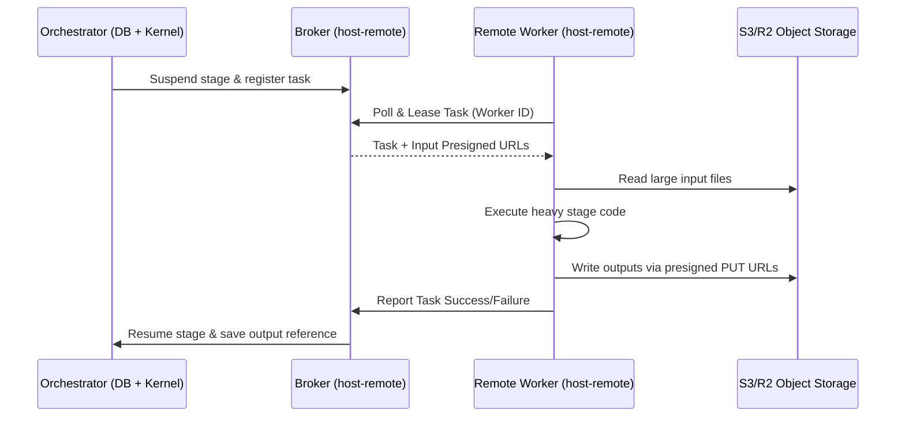

# Remote Activity Workers

The **Remote Activity Worker** package (`@bratsos/workflow-engine-host-remote`) allows you to run heavy or specialized workflow stages (e.g. video transcoding, ffmpeg processing, or deep LLM inference) on separate, ephemeral worker machines. 

Under this model, the worker nodes hold **zero standing credentials** (no database connection, and no root object-storage credentials). The worker leases tasks from the orchestrator, writes large binary outputs directly to object storage via **presigned URLs**, and reports execution results back to the central orchestrator using HTTP.

---

## Architecture Overview



---

## Wiring Models

### 1. Proxy Stage (Recommended for Long Tasks)
Use `defineRemoteStage` to wrap your heavy stage definition. When reached, the orchestrator suspends the stage, registers it on the broker, and waits for a worker to execute it and report back. This releases the core job lease so the orchestrator isn't locked while waiting.

```typescript
import { defineRemoteStage } from "@bratsos/workflow-engine-host-remote";
import { defineWorkflow } from "@bratsos/workflow-engine";

const workflow = defineWorkflow({ ... })
  .pipe(defineRemoteStage(heavyVideoStage, oTransport, {
    pollIntervalMs: 5_000,
    maxWaitMs: 3_600_000, // 1 hour timeout
    stageCodeVersion: "v1", // Must match the version on the workers
  }))
  .pipe(cleanupStage)
  .build();
```

### 2. ActivityExecutor Port (Short Tasks / Custom Routing)
Alternatively, you can route execution dynamically using the kernel's `ActivityExecutor` port. The default executor is `createLocalExecutor()`, but you can wrap it with `createRoutingExecutor` to delegate select stage IDs to remote hosts:

```typescript
import { createRemoteExecutor } from "@bratsos/workflow-engine-host-remote";
import { createRoutingExecutor, createLocalExecutor } from "@bratsos/workflow-engine/kernel";

const kernel = createKernel({
  ...,
  executor: createRoutingExecutor({
    remote: createRemoteExecutor(oTransport),
    remoteStageIds: ["heavy-transcode", "batch-embedding"],
  }),
});
```

---

## Configuring the Worker Fleet

Workers run in their own process, loading only `@bratsos/workflow-engine-host-remote` and the specific stage code (no Prisma client, no direct DB dependencies).

```typescript
import { createActivityWorker, createHttpWorkerTransport } from "@bratsos/workflow-engine-host-remote";
import { transcodeStage } from "./stages/transcode";

const transport = createHttpWorkerTransport({
  baseUrl: "https://orchestrator-broker.internal",
  authToken: process.env.BROKER_AUTH_TOKEN,
});

const worker = createActivityWorker({
  workerId: "worker-gpu-1",
  stageIds: ["heavy-transcode"],
  stageCodeVersion: "v1",
  registry: new Map([["heavy-transcode", transcodeStage]]),
  transport,

  // Optional (v0.11+)
  onError: (error, { consecutiveFailures }) => {
    // Called when the poll/execute loop encounters errors (e.g. auth, lease fencing)
    console.error(`Worker error: ${error.message}. Consecutive failures: ${consecutiveFailures}`);
  },
  maxBackoffMs: 30_000, // Caps backoff delay between consecutive failures (default: 30s)
});

worker.start();
```

Every option that reaches a timer must be a number of milliseconds from `1` to `2147483647` (the longest delay a timer honours, about 24.8 days): the worker's `heartbeatMs` (default `5000`), `idleDelayMs` (`500`, also the base of the failure backoff) and `maxBackoffMs` (`30000`), and `createRemoteExecutor`'s `pollEveryMs` (`5`). `Infinity`, `NaN`, zero, a negative number or a larger value makes `createActivityWorker` or `createRemoteExecutor` throw a `RangeError` that names the option, because a timer fires after 1 ms on such a value (a heartbeat every millisecond, a poll loop with no pause). `pollIntervalMs` and `maxWaitMs` are not timers: they travel to the broker as a worker hint and a deadline.

---

## Configuring the Orchestrator (Broker)

The orchestrator serves the HTTP endpoint that workers connect to.

```typescript
import { Broker, InMemoryBrokerStore, createBrokerHttpServer, createS3Presigner } from "@bratsos/workflow-engine-host-remote";

const presigner = createS3Presigner({ 
  bucket: "my-artifacts", 
  region: "us-east-1" 
});

const broker = new Broker({
  store: new InMemoryBrokerStore(),
  presigner,
  stageCodeVersion: "v1",
  clock: { now: () => new Date() },
});

// Start the HTTP listener
const server = createBrokerHttpServer({ 
  broker, 
  objectStore: presigner, 
  authToken: process.env.BROKER_AUTH_TOKEN 
});
server.listen(3000);
```

---

## Hosting on Other Platforms

`createBrokerHttpServer` is a convenience wrapper around `handleBrokerRequest`, a **platform-agnostic** handler with no `node:http` dependency — it takes a plain `IncomingRequest` and returns a plain `HandlerResponse`. Call it directly to host the broker on any `Request`/`Response`-based platform — a Cloudflare Worker, Deno, Bun, an AWS Lambda function URL, or a framework like Express, Fastify, or Hono — by adapting that platform's request and response to and from the handler's shape.

For example, wiring it into a Cloudflare Worker `fetch` handler (reusing `broker` and `presigner` from above):

```typescript
import { handleBrokerRequest, type BrokerServerDeps } from "@bratsos/workflow-engine-host-remote";

const deps: BrokerServerDeps = { broker, objectStore: presigner, authToken: process.env.BROKER_AUTH_TOKEN };

export default {
  async fetch(req: Request): Promise<Response> {
    const url = new URL(req.url);
    const result = await handleBrokerRequest(deps, {
      method: req.method,
      path: url.pathname + url.search,
      headers: Object.fromEntries(req.headers),
      body: await req.json().catch(() => null), // binary /blob PUTs: populate rawBody instead
    });
    const body = result.binary ?? (result.status === 204 ? null : JSON.stringify(result.json ?? null));
    return new Response(body, { status: result.status });
  },
};
```

---

## Durability, Fencing, and Safety

### Durable Reports
To prevent duplicate execution when the orchestrator restarts, workers write their results to a deterministic key in object storage *before* calling the HTTP `/report` API. On restart, the proxy stage reads this object storage reference and recovers the completed state automatically.

### Known limits of the blocking `createRemoteExecutor`
The `ActivityExecutor` route (not the proxy stage) has these limits:
* **One task id for every attempt.** The executor submits each stage attempt under the stage record id. While the broker still holds the earlier attempt's task, a retry of the same stage record (a job retry, a redrive that reopens the record in place) gets that task's report back instead of running the worker again. The broker keeps a reported task until it restarts, so every later delivery gets the first report back and the worker never runs again: a stage that fails once fails every retry, whatever its `maxAttempts`. Route a stage whose retries matter through the proxy stage.
* **Broker state loss repeats work.** The executor reads the outcome only from the broker. If the broker forgets a task (an in-memory broker restarts), the executor submits it again and the worker runs again, even when the worker already wrote its durable report. Workers behind this route must be safe to repeat.
* **Reports and run retention.** This route's workers write reports under `remote-activity/<runId>/`, which `run.purge` does not remove; reports can hold outputs, logs and annotations, so delete them with your own retention job, for example by listing `remote-activity/<runId>/` for each id `run.purge` returns. The proxy stage's reports go under its `artifactPrefix`, `workflow-v2/<workflowType>/<runId>/<stageId>/remote/`, inside the run's folder: when workers write to the same blob store the engine uses, `run.purge` deletes them with the run; when they write to separate storage, nothing deletes them, and the same retention job must cover that prefix there.

### Fencing & Cancellation (v0.11+)
When a workflow is cancelled on the orchestrator, active jobs are marked as cancelled. During the worker's heartbeat poll, the broker detects the cancellation and sends a cancel signal to the worker.
* The worker ignores the output presigning and skips reporting to object storage, avoiding errors from executing reports on expired/fenced leases.

### Version-Lock Safety
Bumping `stageCodeVersion` acts as a deploy barrier. If a task was suspended using version `v1` but a worker attempts to fetch it with version `v2`, the broker rejects the lease, preventing code mismatch errors.

### Failures and retries
A stage that throws on a worker is reported as a failed outcome carrying the message, the error's `name` and the worker's retry verdict. The worker reaches the verdict with the kernel's own classifier: a `NonRetryableError`, a Zod error (from any copy of zod) and the other errors retrying cannot change are reported `retryable: false`. Through the `ActivityExecutor` port, the `RemoteExecutor` hands both to `job.execute`, so the job is not retried and the stage records the same text a local stage would (`"QuotaError: over quota"`). A stage input that fails validation on the orchestrator is non-retryable too, as with `LocalExecutor`.

Both fields are optional on the wire. A report without them (a worker from an earlier release) is retryable and records the bare message, as before, and a broker from an earlier release drops them. A proxy stage built with `defineRemoteStage` fails the run on any failed outcome, retryable or not: its `checkCompletion` returns the failure as `{ error }`, which is terminal, under the error's name when the message is empty.

### What the worker's stage context carries
The activity worker builds the stage context by hand, so a stage that runs remotely gets the full `StageContext` contract with these limits:
* **`ctx.step`** is present but has no ledger: every `ctx.step.*` call throws `StepLedgerNotConfiguredError`. [Durable steps](../core-concepts/durable-steps.md) run on the orchestrator's stages, not on remote workers.
* **`ctx.ai`** and **`ctx.aiLogger`** throw `AIServicesNotConfiguredError` until the remote host wires services; create an `AIHelper` directly in the stage if it needs one.
* **`ctx.abortSignal`** never fires — the kernel's heartbeat-driven abort does not cross the worker boundary. Cancellation reaches the worker through the broker's lease fencing described above.
